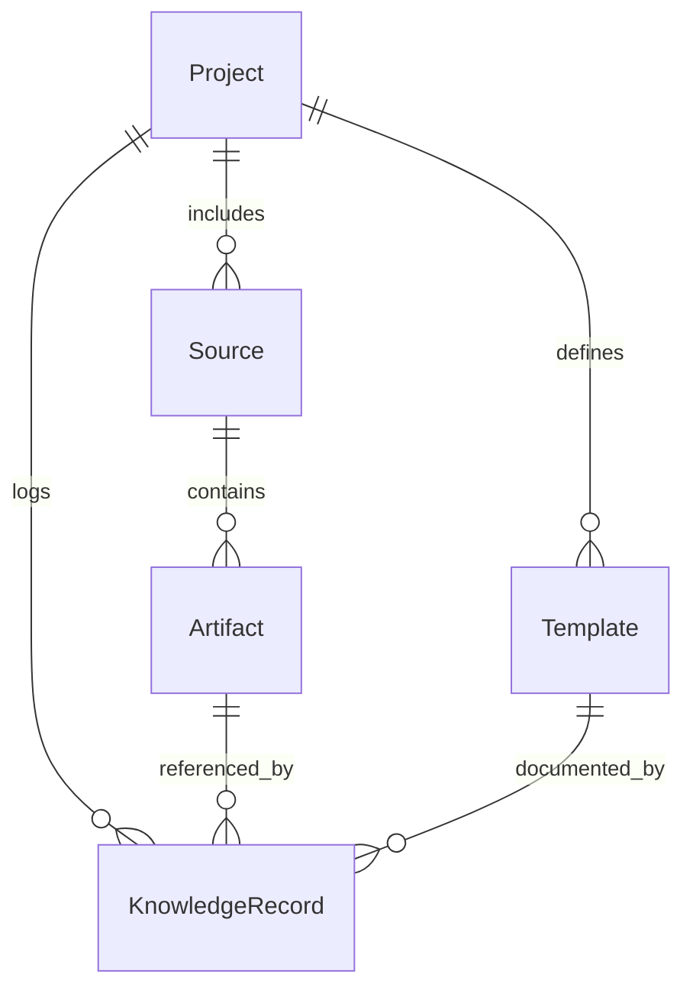
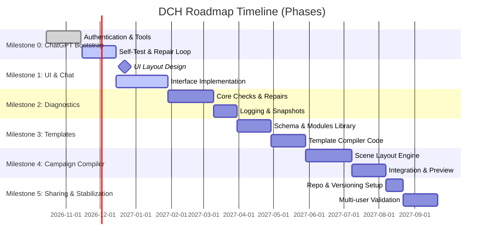

# DiceBox Campaign Helper (DCH) Roadmap v2 — Executive Summary


## Owner-aligned AI-first execution charter — November 17, 2026

**Status: governing interpretation of this roadmap.** This charter reconciles the original August 23 Campaign Director architecture, the approved November workstation layout, and the owner's November 17 statement of intended functionality. It clarifies priorities without deleting historical milestones, tests, or evidence. When later legacy sections discuss an editor-led workflow, self-development as the end goal, or a multiuser marketplace, this charter takes precedence.

### One product, one primary operator

**DiceBox Campaign Helper is a fully AI-operated, conversation-first Foundry VTT campaign creation and management studio.** A user describes a complete campaign, adventure, scene, or change in ordinary language. The **internal ChatGPT Campaign Director** coordinates planning, generation, validation, repair, saving, and authorized Foundry installation. It must be able to create or update:

- Story and campaign structure: setting, lore, locations, quests, branching encounters, journals, dialogue, handouts and continuity.
- Scene geometry and presentation: true 90-degree overhead semantic layout, room/wall/door geometry, map artwork, textures, tiles, lighting, Regions, triggers, environmental effects, and player/GM previews.
- Playable content: Actors, monsters, NPCs, tokens, portraits, Items, equipment, treasure, spells, mechanics, puzzles, traps, scripted interactions and rewards, within the selected Foundry game system.
- Project operations: content references, asset storage, version history, diagnostics, correction, testing, deployment receipts, and recoverable changes.

**No mandatory manual editor workflow.** ChatGPT operates semantic SceneCommands, the map/canvas engine, asset-generation providers, and Foundry adapters directly through typed, authenticated application tools. The GM can use the visual editor, Inspector, and advanced controls for optional adjustments; they must not be required to draw every wall, manipulate IDs, write scripts, or configure puzzle Regions to complete an ordinary campaign request.

**Application execution authority remains deterministic.** The AI decides creative intent and selects tools; DCH validates schemas, geometry, permissions, content provenance, state revisions, approvals, and persistence. The canonical scene and campaign data belong to DCH, not to transient chat prose, image output, or an independent Codex process. Codex is an optional scoped technical builder for development and complex repairs, not a second required user-facing assistant.

### Approved desktop experience

Retain the owner's hand-made panel structure and approved GitHub-dark visual template: top-left File/Edit/Select/View/Help menus, left sidebar listing **user-created campaigns**, ChatGPT-style conversation with collapsible receipts/metadata, a dominant 90-degree vertical/top-down semantic workspace, upper-right **actual implemented/player-view scene** preview when rendering is proven, and lower-right optional Inspector/diagnostics. A local illustration or approved-background preview must never be labeled as a real Foundry render without an authenticated Foundry-session receipt.

The normal flow is **describe → AI plans → AI builds → automated validation and revision → preview → save → authorized install/play**. The user's conversational request should automatically move all relevant campaign parts together; for example, flooding a dungeon updates its geometry, map art, effects, Regions, puzzle conditions, encounters, journals and preview consistently.

### Corrected development priority — complete creative vertical slice

This work is **one parallel program**, not a requirement to finish a manual editor or autonomous source-code editing system before creating gameplay content.

1. **Internal chat foundation and tool discovery (M0/M1):** Make selected-account login, conversations and campaign context reliable. Expose a truthful, versioned native tool catalog with permissions, arguments, results and error receipts. Organize menus, diagnostic tools, source/receipt disclosures and user-readable progress. The existing read-only assistant is an *interim stage*, not the final Campaign Director.
2. **Campaign Director command loop (M0/M2/M4):** Implement natural-language request → typed CampaignPlan and SceneCommands → DCH validation → apply to disposable/saved project → inspect result → automatic bounded repair → undo/recovery. Routine creation within an authorized project should not require manual scene-editor clicks; consequential changes and Foundry installation keep explicit safeguards.
3. **Content-generation adapters (M3/M4):** Add reusable, provenance-tracked tools for battlemap artwork, assets, Actors, Items, journals, encounters, lighting and linked Regions/puzzle templates. Preserve semantic coordinates as authoritative. Prefer original approved art assets and fail visibly when required generation or verification is unavailable.
4. **Foundry compile, installation and player-view proof (M2/M3/M4):** Apply generated content through the selected world/game system's verified APIs and permissions, test relationships and interactive mechanics in a disposable authorized Foundry world, and compare the actual player view to semantic/render intent. A Tauri/WebView2 desktop wrapper is not itself a substitute for this integration.
5. **First end-to-end user acceptance (cross-milestone):** From one chat prompt, create a **playable short encounter** with a map, artwork, at least one Actor, Item, light, Region, and working key/door puzzle; compile it, validate both success and failure branches, show the actual Foundry preview, preserve continuity and recovery, and issue a verifiable completion receipt. The user should not need to open the manual canvas.
6. **Complete campaign scale-up:** Extend the proven encounter workflow to a coherent multiscene campaign, consistent world/lore/character state, generation and repair of dependencies, cross-scene travel and content, durable project history, and resumable conversations.

**Near-term sequence:** finish DCH menu/diagnostic/chat-tool setup; prove the first AI-authored, validated SceneCommand/ProjectCommand against a disposable campaign; connect map and game-content generators; then prove Foundry integration. Additional manual editor features must demonstrate that they support the AI command loop, not replace it.

### Honest acceptance and current scope

- M0's previous formal acceptance state remains **NOT_ACCEPTED (0/8)** until its original security/native-return criteria are independently met. Do not turn isolated UI tests, build success or source-only proposals into claims of production acceptance.
- The approved desktop UI, local illustrative scene renderer, and selected saved-background hash-verification pipeline have reported isolated development checks. They are *building blocks*, not proof of automated complete-campaign creation or actual Foundry player rendering.
- **Owner's current deployment scope is a private personal-use application.** Cross-user distribution, an online marketplace, public publishing, and generalized enterprise workflows are *optional future proposals*, not priorities or acceptance dependencies. Preserve the historical Milestone 5 discussion for context, but do not treat it as currently authorized work.
- Source, reusable templates, roadmap, changelog and continuity should be centrally versioned (GitHub-first where appropriate), keeping only required runtime/cache/credential material on the computer. Project-private materials must not be uploaded indiscriminately; credentials remain in approved secure stores. Preserve the existing dirty worktree and installed Foundry data until reconciled—never assume a broad commit/reset/stash or install is safe.
- This GitHub roadmap is the **single governing product roadmap**. Earlier August Stage 12 plans, stale Codex project states and exploratory architecture documents remain evidence/history. Update Foreman, Switchboard and agent startup pointers to this document; do not maintain a competing active roadmap. Individual work-unit checklists may track execution without changing this priority order.

---


DiceBox Campaign Helper (DCH) is envisioned as a **conversational AI-operated campaign development environment** for Foundry VTT.  In contrast to traditional module editors, DCH puts **ChatGPT at the center**: the GM describes what they want, and ChatGPT (via the DCH Desktop App) **automatically generates, installs, and verifies** all campaign content.  The guiding principle is that *no GM should need technical expertise*: diagnostic checks, repairs, and Foundry integration are handled internally. 

The original Roadmap v2 established **Priority 0: ChatGPT Bootstrap** as an engineering proof that authenticated AI tooling can inspect, build, and verify DCH. That security and self-development milestone remains independently gated, but the **owner-aligned November 17 charter above** makes clear that the *product* is the user-facing **ChatGPT Campaign Director**: its purpose is to automatically create and maintain playable campaigns. Self-development capability is supporting infrastructure, **not the application’s primary function or an indefinite prerequisite for creative automation**.

Milestones 1–4 deliver the persistent conversational desktop, automatic diagnostics and repairs, reusable puzzle behavior, and the complete campaign compiler. **Milestone 4 and the cross-milestone playable-encounter test are the core user-facing capability target.** Milestone 5's original cross-user ecosystem proposal is retained as historical context and is **deferred** for this owner's private personal-use installation. The operational development order and optional-editor rule are defined by the governing charter above. A GM should be able to say, for example,

> “Create a haunted study with a grandfather clock that only opens with the Old Iron Key,”  

and DCH will produce the map, assets, puzzle Regions, clue text, installation into Foundry, and a verified scene preview — all without the GM touching any code or Foundry internals.

Key highlights of this plan:

- **Product Mission:** DCH enables any GM to *create, prepare, install, and maintain* Foundry VTT campaigns *via conversation*, with ChatGPT handling all technical tasks.  The GM stays in a creative “story mode” while DCH automates the plumbing behind the scenes.
- **Milestones:** We define Milestones 0–5 (below) that progressively build this capability, with clear acceptance criteria at each stage.
- **Architecture:** DCH is standalone (no dependence on other modules).  It uses a Tauri+React+PixiJS desktop app to match Foundry’s web-tech framework【25†L712-L719】【58†L101-L106】.  We will integrate with local Git/GitHub for source control, Google Drive/Docs for shared design notes, and Foundry itself (via the DCH module) for installation and verification.
- **Data Strategy:** All code, knowledge records, and templates are centralized in a single **development evidence database**.  This allows versioning of battle-tested templates and automatic regression checks.  (See ER diagram below.)
- **Modular Templates:** Puzzle logic will be defined by JSON templates that specify chained behaviors (trigger, item-check, text, unlock, etc.).  These templates can be used by ChatGPT or by a future Regionwright: Studio GUI interchangeably.
- **CI/Test & Safety:** We will set up a CI pipeline (e.g. GitHub Actions) that runs automated regression tests on each change, with safe rollback if a test fails.  Foundry scenes (lighting, walls, Regions) will be checked in-situ to ensure they work as intended.
- **Security Model:** Each user/GM uses their own ChatGPT account (or their own OpenAI API key); **no account sharing** is allowed【3†L444-L449】.  ChatGPT-driven publishing will be managed via Git workflows (pull requests, branch protection) so that nothing is merged without review.

Below is the detailed plan, with milestones, requirements, diagrams, and next steps.

---

## Product Mission

**“DCH lets any Game Master build and manage entire Foundry VTT campaigns by speaking, not coding.”**  More precisely:

- **Conversational Control:** The GM interacts primarily through natural language chat.  They instruct or describe campaign elements (“Add a locked chest in the cavern that needs a magic key to open”) and DCH (ChatGPT + Desktop App) implements them in Foundry.
- **AI-Based Automation:** ChatGPT acts as both *creative advisor* and *technical builder*.  It proposes narrative details and also writes underlying Scenes, Regions, Actors, Items, etc.
- **Complete Workflow:** DCH handles *all* steps from initial idea to playable world.  This includes scene composition, asset placement, wall and lighting setup, NPC creation, inventory items, puzzle logic, and even installation into a live Foundry world.
- **No Technical Barrier:** The GM should never see code, scripts, or error logs.  Behind the scenes, DCH automatically diagnoses and fixes problems (missing walls, broken scripts, etc.)【50†L39-L47】.  The interface shows progress/status, but not raw errors.
- **Adaptable & Verifiable:** Campaign definitions are stored and versioned.  The desktop app can re-run any build to verify that *every installation step works reliably*.  Failures trigger automatic rollback and repair attempts.

This mission is a deliberate departure from a typical module editor.  Instead of “tools to draw walls and place regions,” DCH is an **AI-powered campaign compiler**.  The user experience should feel like talking to an RPG-savvy assistant who also knows how Foundry works under the hood【50†L39-L47】【58†L101-L106】.  

---

## Prioritized Milestones and Acceptance Criteria

We organize development into **Milestones 0–5**, in order of priority.  Each milestone has clear functionality goals and acceptance tests.  (Milestone 0 is the highest priority because it unlocks everything else.)

- **Priority 0 – Milestone 0: ChatGPT Bootstrap**  
  *Goal:* Enable ChatGPT to fully control the DCH development environment and verify changes without human help.  
  *Key Outcomes:* ChatGPT (acting via the DCH Bridge/tooling) can query the codebase, edit files, run build commands, install the DCH module into a local Foundry world, and run automated tests.  If tests fail, ChatGPT should diagnose and fix trivial issues (e.g. missing dependencies).  All fixes are logged as evidence.  
  *Acceptance:* ChatGPT successfully makes a small change (e.g. fixes a typo or increments a version number) and executes the build/install pipeline.  The system produces a self-contained evidence record showing build success and any auto-repairs performed.  (No GM intervention should be needed.)  

- **Milestone 1: Conversational Desktop Interface**  
  *Goal:* Implement the user interface sketched above: a persistent Chat panel, a contextual Workspace, a real-time Scene Preview, and a status/diagnostics panel.  
  *Key Outcomes:* The GM always sees the Chat on the left, which retains the conversation history for continuity.  The Workspace center changes form based on context (scene editor, text editor, asset browser, etc.).  The right-hand panel shows a scaled preview of the current scene.  Technical logs (compilation progress, health indicators) are visible but non-intrusive.  Panels are resizable and collapsible as needed.  
  *Acceptance:* A user can start a new campaign conversation and see ChatGPT’s messages in the chat panel.  When ChatGPT says “Generating a scene…”, the scene appears in the preview panel.  The UI should never expose raw JSON or console logs to the GM.  (We may skip actual chat with ChatGPT at this stage, but the interface must be fully functional in offline/test mode.)

- **Milestone 2: Automatic Diagnostics & Repair**  
  *Goal:* Build the self-monitoring engine.  DCH should automatically verify every Scene, Region, script, and install step, and apply safe fixes.  
  *Key Outcomes:* Upon building a scene, DCH runs a checklist (walls closed, no missing textures, scripts loaded).  If a problem is detected (e.g. a Region’s target object is missing), DCH logs the issue, attempts a predefined repair (e.g. recreate missing object or skip invalid script), and reruns the check.  The GM is only alerted if a nontrivial intervention is needed.  All repair actions are reversible (a recovery snapshot is kept).  
  *Acceptance:* The system can deliberately introduce a fault (for example, remove a required wall) and ChatGPT (through DCH) automatically reinstalls the wall and verifies the fix without GM input.  A test suite of common scene/puzzle faults should pass automatically.

- **Milestone 3: Modular Workflow Engine (Templates)**  
  *Goal:* Convert our manual scene-and-puzzle recipes into reusable, versioned JSON templates.  ChatGPT will use these building blocks.  
  *Key Outcomes:* Define a **Puzzle Template Specification** (JSON schema) that describes chainable behaviors (region triggers, item checks, text displays, unlocks, etc.).  Implement a template compiler in DCH that takes such a JSON template and sets up the corresponding Foundry entities (Regions, Item requirements, Active Effects, etc.).  Provide a library of core templates (locking mechanisms, puzzles, traps) that can be parameterized by ChatGPT from GM input.  
  *Acceptance:* ChatGPT can execute a conversation command that maps to a template.  For example: “When the player examines the clock, check for Item ‘Old Iron Key’; if present, unlock the door.”  The system should instantiate the right template (e.g. Key-Item Puzzle) and produce a working Foundry scene.  A test case with that scenario (key present vs absent) should produce the correct outcome without script errors.

- **Milestone 4: Complete Campaign Compiler**  
  *Goal:* Automate end-to-end campaign construction from GM descriptions.  This includes scene layouts, asset placement, NPCs, journals, audio, lighting, and puzzle integration.  
  *Key Outcomes:* ChatGPT should be able to handle requests like “Generate a haunted mansion level with X, Y, Z” and combine modular pieces into a coherent whole.  The engine will place furniture (from an asset library or uploaded art), compute walls and doors from room descriptions, set up lighting ambiance, and wire up any needed puzzles or encounters using the templates from M3.  After assembly, DCH performs a full build/install and provides the GM with a fully playable scene preview.  
  *Acceptance:* A complete example scenario (e.g. a small haunted library) should be producible end-to-end.  The acceptance test might be: “ChatGPT builds a study with a working grandfather clock puzzle (as described), installs it in Foundry, and demonstrates the correct puzzle behavior.”  The scene preview must match the GM’s request visually and functionally.

- **Milestone 5: Shared Knowledge & Ecosystem**  
  *Goal:* Enable cross-user sharing of improvements, and optional integrations.  Finalize the long-term architecture.  
  *Key Outcomes:* The DCH development knowledge base (templates, fixes, code examples) is stored in a repository accessible to multiple users/instances.  Different GM accounts can pull approved templates and diagnostic patches from this shared repo.  We’ll define a process for ChatGPT to propose improvements (via pull requests) that human reviewers can approve.  Optionally, confirm Regionwright: Studio compatibility by making the same templates usable without DCH.   
  *Acceptance:* A developer ChatGPT can publish a new template version to GitHub, and a separate GM ChatGPT can fetch and use it in a build, without leaking campaign-private data.  The roadmap will also finalize plans for any optional plugins or marketplace listing.

Each milestone overlaps somewhat (e.g. basic diagnostics are needed early), but this breakdown helps target deliverables.  We will **preserve our existing Stage 12 roadmap** as historical reference; all changes above are *additive sequencing* by owner decision, not overwriting old evidence.

---

## Engineering Implementation Plan

To meet the above milestones, we map current code and assets into the new plan:

- **Codebase & Tools**: The DCH Desktop App (Tauri v2 + React + TypeScript + PixiJS) is our central UI.  A private native module (the *DCH Bridge*) exposes build/install commands and diagnostics to ChatGPT under the hood.  We will extend both as needed:
  - *Stage 0 tasks:* Harden the Bridge/utility harness so ChatGPT can invoke *build*, *run diagnostics*, *restart Foundry*, etc. via authenticated calls.  Create a secure credential scheme so the AI agent (and only it) can issue privileged commands on the desktop (like a local ChatGPT API connection tied to the app).  
  - *Inventory:* The current repository has uncommitted changes (#823 in working-tree) and separate evidence repos. We’ll consolidate these via Git HEAD indexing (scanning local diffs) while syncing with GitHub branches. Migrate any vital code from the uncommitted changes into feature branches, preserving history in the evidence DB.

- **UI Construction** (Milestone 1):  Reorganize the current React layout per the user’s sketch.  The **left pane** will host a persistent Chat component; we can reuse a chat-widget or build a simple one with message history.  The **center workspace** will switch between editors (map editor, text editor, journal editor, asset browser) as directed by ChatGPT.  The **right preview** will embed the PixiJS-rendered scene from Foundry’s compiled data.  We’ll also create a bottom or secondary panel for status info (build progress, diagnostics summary).  This uses existing React components (Map Preview, Inspector) but re-flowed.  We must ensure the Chat UI retains full history (supporting references to prior instructions).  
  - We’ll add state management so each panel is resizable/collapsible.  ChatGPT outputs (via the Bridge) will direct which component to show.  
  - *Testing:* Verify the UI can display an offline example scene and that chat messages persist when workspace context changes.

- **Diagnostics Engine** (Milestone 2):  Leverage the DCH utility harness to implement rules from our consolidation database.  For each Scene or asset generated, run a verification script: e.g.  
  - **Scene Integrity:** Ensure closed walls. If a gap is found, auto-add a wall.  
  - **Regions & Triggers:** Confirm each Region’s `event` and `target` exist. If a Region refers to a missing item, remove the Region or add a placeholder item.  
  - **Scripts & Macros:** Check that any embedded scripts (e.g. puzzle macros) loaded without errors (catch exceptions). If a script fails, attempt a known fix (replace with robust default script from DB).  
  - **Asset References:** If a map or image file is missing, revert to a backup copy or report an error.  
  Each check logs a pass/fail and any repair action. We’ll store snapshots so fixes can be undone if undesired.  The GM sees only high-level summaries (“All checks passed” or “Repaired missing wall in Bedroom”).

- **Template Engine** (Milestone 3):  We will encode the *Puzzle Sequence Composer* described earlier.  Design a JSON schema where each “module” in a puzzle is one node in a sequence graph.  For example, a lock puzzle might be:  
  ```json
  {
    "type": "PuzzleSequence",
    "chain": [
      {"module": "InspectRegion", "region": "clock", "message": "The clock ticks loudly."},
      {"module": "RequireItem",   "itemId": "ironKey", "failMessage": "It's locked."},
      {"module": "UnlockDoor",    "doorId": "studyDoor", "successMessage": "Door opens."}
    ]
  }
  ```  
  Each module type (InspectRegion, RequireItem, UnlockDoor, DisplayText, PlaySound, Teleport, etc.) is implemented as a reusable behavior.  ChatGPT will fill in the parameters (IDs, texts, targets) based on GM instructions.  We’ll maintain a **Module Registry** (editable JSON) so new behaviors can be added later.   
  Implementation: The compiler will parse the JSON, create the corresponding Foundry Region objects, attach ActiveEffect flags or Item checks, and wire success/failure flows.  We will write unit tests for each module type.  These templates will be stored in the evidence DB with version tags, allowing Regionwright: Studio to later import/export them.  
  - *Testing:* A fixture validator (from consolidation) already checks for circular chains, missing parameters, etc.  We’ll use that to ensure all saved templates are well-formed before ChatGPT can use them.  

- **Campaign Compiler** (Milestone 4):  Build on our existing scene-builder logic (the “Scene Compiler” from earlier stages).  Convert GM descriptions into scene blueprints.  For example, if ChatGPT learns that “the study is 10x8 meters with a window on the north wall,” it creates an empty scene of that size with a wall rectangle and one window Tile.  We will compile a library of scene layouts (e.g. simple room, hallway, circular chamber) that ChatGPT can parameterize.  Furniture and props will come from either the foundry data or user-uploaded assets (see UI: asset library).  ChatGPT can place generic objects (chair, table) to match “cozy study with desk and chairs.”  
  Encounters (Monsters/NPCs) and narrative journals will be created as needed.  Lighting presets (warm lamp vs dark torch-lit) will be set according to scene descriptions (e.g. “dim candlelight”).   
  *Integration:* Once ChatGPT finalizes a scene, DCH compiles it into Foundry data, launches the Foundry world via the utility harness, and injects the scene.  The **Scene Preview** panel will then show the actual rendered result (via Pixi) so the GM can confirm it.  
  - *Testing:* End-to-end regression tests. For example, the “small haunted study” scenario described above should run from scratch: given the GM’s prompt, ChatGPT builds the scene, DCH installs it, and the preview demonstrates the clock puzzle working.  

- **Ecosystem & Sharing** (Milestone 5):  We will finalize multi-user support.  All templates, schema definitions, and knowledge-records become part of a versioned GitHub repository (`DiceBox/Templates` etc.).  The DCH app will pull approved schema/logic updates from that repo.  ChatGPT users work in *private branches* for their campaigns, but when a generalized improvement is found, they can issue a pull request to the shared repo.  You (the owner) review and merge it, making it available to all.  
  This also covers finalizing the **Security Model** (see below) and any marketplace packaging (e.g. submitting DCH as a Foundry module or shareable app).  

Throughout this plan, we will **preserve existing code and design**.  All currently implemented features remain; we simply re-sequence them to fit the new ChatGPT-centric flow.  The existing 16-stage Stage 12 roadmap will be kept for reference, but our *current path forward is defined by these milestones*. 

---

## Required Integrations

DCH must glue together several systems seamlessly:

- **Local Version Control (Git):** The DCH app will index the local repository (Git HEAD) to know what code and scenes exist.  This allows ChatGPT to search and modify any part of the codebase.  We will preserve the working tree (#823 changes) by committing or stashing them appropriately.  Git data also provides file fingerprints and last-modified dates for the evidence DB.

- **Google Drive / Docs:** If project notes or assets are stored in a shared Drive, DCH will use the Google Drive API (authenticated with the GM’s Google account) to fetch campaign design docs, images, or tokens.  For example, a GM might upload a map image or NPC portrait; ChatGPT can include it by referencing the Drive file ID.

- **GitHub (Knowledge Repo):** A private GitHub organization will hold the master templates and knowledge.  DCH (via a GitHub integration token) can pull the latest templates or push evidence (e.g. a log of a fixed bug as a new issue).  We will distinguish *read-only access* for GMs (pull templates) vs *write access* for development ChatGPT (commits/pull-requests to merge improvements).  This ensures each GM’s private campaign data is never pushed to the public repo, only generic improvements are.

- **Foundry VTT:** DCH must install scenes and actors into a Foundry game.  We rely on the existing **DCH Foundry Module** as a bridge.  This module (installed in the world) opens a WebSocket or HTTP link to the Desktop App, reporting status and accepting scene data.  The Desktop App also launches Foundry via command-line (e.g. `foundryvtt --dataPath path/to/world`) and monitors it.  At Milestone 0, ChatGPT should be able to trigger this launch and know when Foundry is running.

- **DCH Utility Harness:** The utility harness is the combination of the Bridge and small Node scripts that automate installation.  We will expand it with new commands: e.g. `diagnoseScene()`, `snapshotState()`, `repairMissingObject()`, etc.  These will be callable by ChatGPT via function-calling (or a private API) so that the AI can orchestrate the maintenance loop.

In short, DCH ties together **Git (code), Google Drive (assets), GitHub (templates), and Foundry (runtime)** under ChatGPT’s control.  This integration layer must be robust and documented so the AI can query, modify, and execute in each environment.  (For example, ChatGPT might ask “List all files in the Scenes folder,” which uses Git or the filesystem API.)  

---

## Data Consolidation Strategy (Development Evidence Database)

All artifacts, knowledge, and templates will be recorded in a unified **SQLite database** (as prototyped by our consolidation work).  The schema will track entities such as Projects, Sources, Artifacts, Templates, and KnowledgeRecords.  A simplified ER diagram is shown below:



- **Project:** e.g. “DiceBox Campaign Helper.”  (Could extend to multiple campaigns.)  
- **Source:** External data source (local Git repo, GitHub repo, Google Drive folder).  
- **Artifact:** A file or doc (JavaScript code, scene file, image, doc file) obtained from a Source.  
- **Template:** A reusable workflow or puzzle template (JSON schemas, scene blueprints, etc.).  
- **KnowledgeRecord:** A log entry or evidence fact (“Puzzle X failed test on 2026-10-20, auto-fixed by adding wall,” or “Template Y adopted version 1.2”).

This database ensures everything is traceable.  For example, each Template row stores its JSON content, version tag, and schema type.  Each KnowledgeRecord links to the Template or Artifact it concerns (via foreign keys).  The `Source–Artifact` link shows whether something came from GitHub or Drive.  

Whenever ChatGPT or a developer makes a change, the action is recorded: modifying a file creates or updates an Artifact row; proposing a template adds a Template entry; a fix adds a KnowledgeRecord with a description.  The database can be queried (via a UI or ChatGPT plugin) to answer questions like “What changed in Template A since last version?” or “Which KnowledgeRecords mention 'wall repair'?”.  

By consolidating in SQLite, we get ACID safety and complex queries.  (In the future we might migrate to a server DB for real-time collaboration, but SQLite suffices for now.)  

---

## Modular Puzzle Template Specification (JSON Schema Outline)

We will define a versioned JSON schema for puzzle sequences.  Key concepts include:

- A **Puzzle Sequence** consists of ordered modules (nodes), each of a specific *type* with parameters.  
- Common module types: `InspectRegion`, `DisplayText`, `RequireItem`, `CheckFlag`, `SetFlag`, `UnlockDoor`, `GrantItem`, `Teleport`, `PlaySound`, `Sequence` (branching logic), etc.  
- Each module specifies the in-scene targets (region IDs, item IDs, etc.) and any messages.

Here is an illustrative JSON example of a simple “locked clock” puzzle:

```json
{
  "sequence": [
    {
      "type": "InspectRegion",
      "regionId": "clockTrigger",
      "message": "The grandfather clock ticks ominously."
    },
    {
      "type": "RequireItem",
      "itemId": "OldIronKey",
      "failMessage": "It's locked tight; you need a key."
    },
    {
      "type": "UnlockDoor",
      "doorId": "studyDoor",
      "successMessage": "The key turns; the door creaks open."
    },
    {
      "type": "SetFlag",
      "flag": "clueRevealed"
    }
  ]
}
```

Each object in `"sequence"` corresponds to one step.  For instance:
- `InspectRegion` displays a clue text when the player enters a hidden region (`clockTrigger`).  
- `RequireItem` blocks progress until the player has the specified item (`OldIronKey`), showing `failMessage` if not.  
- `UnlockDoor` performs a door action and shows `successMessage`.  
- `SetFlag` records that the puzzle is solved (so text clues or repeats behave differently).

Our engine will translate this into Foundry: it will create the Region, attach a conversation or popup for the text, add an ActiveEffect that watches the player’s inventory for the item, and tie the flag to a Journal entry or Scene note.  All built-in module behavior is pre-coded, so ChatGPT never writes raw JS; it just plugs in IDs/texts.

A future Regionwright: Studio GUI could use the *same JSON* by offering visual blocks for each `type`.  No AI code is required to run the puzzle – these JSON templates are “AI-independent.”  ChatGPT’s role is to **choose** the right template and fill in parameters based on GM wording. 

---

## CI and Testing Strategy

We will establish a continuous-integration pipeline (e.g. GitHub Actions) that exercises DCH on each commit. Key elements:

- **Unit Tests:** For critical functions (template compiler, diagnostics routines, database methods).  Any JS/TS logic should have Jest or Mocha tests.  
- **Integration Tests:** 
  - **Scene Builds:** Define a suite of example campaign snippets (like the haunted study).  On each build, ChatGPT (in test mode) generates those scenes and DCH installs them into a sandbox world.  The harness then simulates a player action (if possible) and checks expected outcomes (e.g. door unlocked only with key).  
  - **Regression Suite:** Each verified campaign (from prior milestones) becomes a regression test. We keep baseline snapshots of known-good scenes and compare after changes.  
- **Static Analysis:** Run linter/TypeScript checks on code and JSON schema validator on all saved templates before merging.  
- **Safe Rollback:** Every automated change (especially those applied by ChatGPT) should save a recovery point.  If a test fails, the pipeline will automatically revert to the last commit and report failure.  We will use Git’s stash or temporary branches for snapshots.
- **Deployment Tests:** When DCH installs or updates the DCH Foundry module, we will verify Foundry’s startup logs to ensure no errors.  We may script Foundry to run in headless or test mode to log any module errors.

While no single external source covers “CI for Foundry modules,” we apply general CI/CD best practices.  For example, GitHub’s docs recommend branch protections and auto builds【60†L5-L7】.  We will also employ semantic versioning: any breaking change to templates or APIs triggers a major version bump.

Because the GM experience demands reliability, we treat a passing pipeline as the true definition of “done.”  ChatGPT should consider a milestone complete only when *all tests pass automatically*, not just when code compiles.

---

## Security and Permissions Model

DCH’s collaborative components require careful access control:

- **ChatGPT Accounts:** As per OpenAI guidelines, *each user should have their own ChatGPT account or API key*; sharing one account among multiple GMs is disallowed【3†L444-L449】.  In practice, each GM connects DCH to ChatGPT through their own login token.  This isolates conversation history and ensures that DM secrets (campaign notes, NPC stats) never leak between sessions.  The development ChatGPT (that updates templates) can be a separate account, but it treats the public repo as read-only knowledge.
  
- **Repository Access:** 
  - The **DCH source repo and evidence DB** should be private to the developers/maintainers.  Regular GMs do not need write access.  
  - The **Templates/Knowledge repo** can be an organization repo with protected branches.  GM bots have pull (read) access to get templates.  Only DevBot (or designated maintainers) have push permission to update templates.  We will require PR reviews for any merges.  For example:

| Model                                | Access Level       | Pros                                 | Cons                              |
|--------------------------------------|--------------------|--------------------------------------|-----------------------------------|
| **Single shared ChatGPT account**    | Owner (full)       | Easy setup (everyone logs into one)  | Violates OpenAI ToS【3†L444-L449】; convo mix-ups; security risk |
| **Individual ChatGPT accounts**      | Owner (full)       | Isolates users; chat context kept    | Each GM needs their own subscription/API key; more tokens used |
| **App-managed API keys per GM**      | App (via server)   | GM inputs key; fine-grained billing  | GM must manage keys; less seamless |
| **GitHub repo (templates)**          | Devs: write, GMs: read  | Centralized template vetting        | Requires review process; possible merge conflicts |

- **DCH Desktop App:** Installation requires authenticated access to the user’s machine (just like Foundry).  We will sign the app for Windows/macOS and advise GMs on enabling “trusted apps.”  The Bridge API between ChatGPT and the local app will use a challenge-response or token handshake to prevent unauthorized use.

- **Foundry World:** DCH requires developer-mode installation of the DCH module into the game world.  We treat the target Foundry world like a secured environment: only DCH (the AI agent) and the logged-in GM can operate it.  We rely on Foundry’s user permissions to prevent unprivileged access.

In summary, each layer – ChatGPT, GitHub, Foundry – uses the principle of least privilege.  Automated fixes by ChatGPT run under a sandboxed user, and any external write (to GitHub or Drive) is gated.  We will document the credential flows and key management thoroughly.

---

## UI Requirements for the Proposed Layout

The user interface must empower the GM with minimal technical clutter.  Key requirements from the design:

- **Persistent Chat Panel (Left):**  
  - Shows full conversation history (user prompts and ChatGPT responses) scrollably.  
  - Supports quick re-run or edit of past prompts.  
  - Always visible by default, but can be collapsed if needed.  
- **Contextual Workspace (Center):**  
  - Dynamically displays the current *active editor or tool*.  For example:
    - Scene Editor (map tiles, walls, lighting controls).  
    - Journal/Story Editor (rich text for notes or clues).  
    - Asset Browser (thumbnails of uploaded props).  
  - Only one mode is visible at a time, as directed by ChatGPT’s responses.  
  - Commands like “Go back to chat” or “Open Asset Browser” switch the workspace.  
- **Interactive Preview (Right):**  
  【46†embed_image】 *Figure: Example integrated workspace showing code/AI in center and tools on the side.*  
  - Displays the *actual Foundry scene rendering* (PixiJS canvas) at a fixed scale.  
  - The preview must allow basic pan/zoom so the GM can inspect details (lighting, shadows, token vision).  
  - Buttons or toggles switch between **Player View** and **GM View** (revealing hidden Regions or notes).  
- **Status & Diagnostics (Bottom/Optional Panel):**  
  - Shows live indicators (build progress bar, “verifying puzzle X…”, health checks passed).  
  - Errors or repair actions appear here quietly (e.g. “Wall missing – added automatically”).  
  - A “Logs” view (collapsible) contains detailed diagnostics for advanced users, but most GMs never need to see it.  
- **Usability Features:**  
  - All panels are resizable (drag edges) so the GM can emphasize chat vs preview as needed.  
  - The application theme should be user-friendly (not overtly “code editor” style), favoring clean layouts and icons.  
  - We’ll add tooltips or help bubbles for less obvious controls (e.g. how to upload assets).  
  - The AI persona in chat should use RPG-friendly language, not code jargon. For instance, instead of “Generates Scene.create() call,” say “I placed the bookshelf in the corner.” This aligns with Foundry’s philosophy of a “best-in-class developer API” that still supports user-friendly tools【58†L101-L106】.  

Importantly, the **UI never asks the GM to write code**.  When ChatGPT needs more info (e.g. what ID is the front door?), it must prompt the GM in natural language (“Which door should unlock? Select from the scene preview.”).  We will prototype a few dialogues to ensure the UI flow is intuitive.

---

## Migration Plan for Uncommitted Work

The existing codebase has significant uncommitted changes. To incorporate them safely:

1. **Inventory & Versioning:**  We have already cataloged all local modifications in `cross-source-inventory-v001.json`.  For any change not yet in Git, we will create a feature branch (e.g. `migration/uncommitted`) and commit the differences.  This branch will serve as a staging area.

2. **Validation:**  Each new commit will run the new CI pipeline.  We must ensure that merging these local changes doesn’t break the build.  Any failing change is deferred or fixed by the AI or developers before integration.

3. **Integration to Milestones:**  We’ll map each legacy change to our milestones.  For example, if the uncommitted work involved initial template engine code, it belongs under Milestone 3.  This helps us know which parts are done vs still needed.

4. **Preserving Evidence:**  All existing development notes (Google Docs, spreadsheets) related to these changes must be linked into the evidence DB.  We’ll attach references from the code commits to the relevant knowledge records, so the historical context is not lost.

This careful migration ensures that no work is discarded and that we start the next phase with a clean, versioned codebase.

---

## Timeline and Risk Assessment

A high-level **gantt chart** outlines the phased timeline (estimates):



*(Dates and durations are provisional; arrows indicate dependencies.)*

**Risk factors** to monitor: 
- **LLM Model Changes:** If OpenAI changes the ChatGPT API or policies (e.g. deprecating model versions), we must update quickly.  
- **Foundry Updates:** Major Foundry releases could break module compatibility. We will lock to a supported V14 environment for initial development, and plan for migration patches.  
- **API Rate Limits:** Extensive use of ChatGPT calls (especially for template assembly) may hit rate limits. We should budget usage and possibly cache expensive operations.  
- **Data Sync:** Ensuring the local Git and remote GitHub stay consistent can be tricky, especially if GMs work offline. We plan periodic sync checkpoints.  
- **User Adoption:** Since DCH redefines the GM’s role, there is UI/UX risk. We will conduct early user tests (with a small GM group) to refine the conversational prompts and layout.

In parallel with development, the **milestone checklists** (especially for M0) will guide daily tasks.  The first 1–2 months focus on getting ChatGPT fully integrated; user-facing features and robust testing come later.

---

## Alternatives Comparison

### Repository Sync Strategies

| Approach                | Description                                              | Pros                                          | Cons                                               |
|-------------------------|----------------------------------------------------------|-----------------------------------------------|----------------------------------------------------|
| **Local Git HEAD Scan** | Use local `git` CLI to index files & diffs.             | Fast offline access; complete history on PC   | Misses remote changes; must `git pull` manually     |
| **GitHub API Sync**     | Query GitHub repo contents via API (read-only).         | Always up-to-date with origin repo            | Requires internet; rate-limited; complexity adds   |
| **Hybrid (Git Mirror)** | Maintain a mirror of GitHub locally via automated fetch.| Combines local speed with up-to-date state     | More complex setup; still potential conflicts      |
| **Manual Export**       | User uploads files/assets via UI or Drive sync.         | Simple; no code changes needed                | Prone to errors; no automatic version tracking     |

The chosen strategy is a *hybrid approach*: DCH will primarily use **Local Git** for speed (especially in offline builds) and occasionally sync with GitHub for global templates.  The local repo is the source of truth for the active campaign; the GitHub repo is the source of truth for shared templates.  A periodic `git pull` (automated by DCH) will merge in new template versions when safe.

### ChatGPT Authentication Models

| Model                               | Pros                                              | Cons                                               |
|-------------------------------------|---------------------------------------------------|----------------------------------------------------|
| **Single Shared Account**           | Simple (everyone uses one login)                   | Against policy【3†L444-L449】; user context leaks; no audit trail |
| **Per-user Account (recommended)**  | Privacy/isolation; conversation history separate  | Each user needs access setup; managing multiple accounts |
| **API Key per User**                | No need to log in to web UI (app uses key)         | Users manage keys; cost tracking per user needed   |
| **Organization App with Users**     | GM logs into DCH app with personal credentials     | Complex to implement; still ties to per-user API   |

We recommend **individual ChatGPT accounts** (or personal API keys).  This respects OpenAI’s user policy【3†L444-L449】 and ensures each GM’s campaign data stays in their own context.  The DCH app will facilitate logging into the ChatGPT API or Chat interface for the active GM user.

---

## Next Actions and Milestone 0 Checklist

**Immediate next steps (focus on Milestone 0):**
- [ ] **Enable ChatGPT–App Authentication:** Set up a secure connection from ChatGPT (via OpenAI’s API) to the DCH Desktop App.  This may involve the user providing an API key or using OAuth for the DCH Bridge to verify the AI agent.
- [ ] **Enumerate Capabilities:** Have ChatGPT query the DCH environment (list files, read code).  Update templates so it can describe what it finds in plain English (e.g. scan for configuration files).
- [ ] **Create a Safe Dev Branch:** Commit all current local changes into a new Git branch.  Ensure the DCH build passes on this branch.
- [ ] **Test Simple ChatGPT Dev Task:** Prompt ChatGPT (as developer) to make a trivial edit (e.g. change a log message string) and rebuild the app.  Verify the change takes effect in a preview or console.
- [ ] **Automated Build-and-Verify Script:** Develop a script that ChatGPT can call, which runs `npm install`, `npm build`, and then the DCH install routine, reporting success or any errors.
- [ ] **Verify Repair Loop:** Intentionally break one known check (e.g. remove a wall from a sample scene), then see if ChatGPT can detect it (through diagnostics) and invoke a repair command via the harness.
- [ ] **Document Results:** Each successful automated fix or build should be committed as evidence.  Populate the evidence DB with a record (Milestone0_Test1, etc.) so we have a provenance of ChatGPT’s actions.

By the end of Milestone 0, we want a **demonstrable “proof-of-automation.”** For example: “ChatGPT changed line X, ran the build, and DCH Desktop reported ‘0 errors’.  This process used commit `abc123` and triggered automatic re-run on success.”  With that in place, we can confidently proceed to build the user-facing interface and higher-level features.