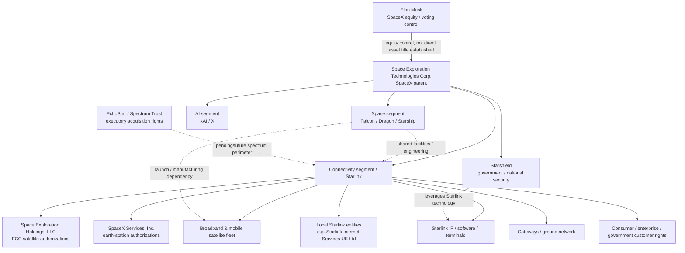

# Starlink Communications: Ownership and Acquisition Perimeter Research Brief

## Executive summary

**Working perimeter conclusion.** The public record does **not** presently support treating “Starlink” as a single, cleanly separable U.S. legal entity that can simply be acquired by buying its equity. Starlink’s own legal page describes Starlink as “a division of SpaceX,” while Space Exploration Technologies Corp.’s June 30, 2026 Form 10-Q describes the consolidated company as operating a **Connectivity segment** that runs the worldwide broadband network through the Starlink offering. At the same time, specific Starlink assets and regulatory rights sit in different SpaceX-group entities: for example, FCC satellite-system authority has been granted to **Space Exploration Holdings, LLC**, whereas an FCC blanket earth-station-in-motion authorization is in **SpaceX Services, Inc.** Local Starlink-branded legal entities also exist, including **Starlink Internet Services UK Limited**. citeturn18search6turn19view3turn27search18turn28search0turn22search1

The most important document found in the initial research is SpaceX’s **March 2, 2026 Bridge Loan Credit Agreement, SEC Exhibit 10.9**. It contains an unusually explicit contractual definition of “Starlink” and “Starlink Financing Assets.” For financing purposes, “Starlink” covers operations and assets related to developing, manufacturing and operating satellite constellations that provide broadband **and** certain government satellite/infrastructure contracts. “Starlink Financing Assets” expressly encompass user terminals and hardware, receivables, royalty and payment rights, Starlink IP, necessary regulatory approvals and licenses, contracts, grants, subsidies, government awards, books and customer lists, and associated proceeds; the definition expressly excludes satellites from the user-terminal hardware clause. This is not itself an M&A perimeter, but it is a strong contemporaneous roadmap to the asset categories SpaceX and its lenders regard as constituting or supporting the Starlink business. citeturn30view0turn31view0

**The principal diligence problem is therefore a carve-out problem, not merely an ownership-chart problem.** The acquisition perimeter should be constructed asset-by-asset and contract-by-contract, with separate columns for legal owner, operating user, regulatory licensee, lien status, transferability, shared use and required post-closing intercompany arrangements. That is especially important because SpaceX’s launch, satellite manufacturing and technical infrastructure support Starlink but also support businesses that should presumptively remain outside the perimeter. SpaceX’s own 2026 disclosures distinguish its Space, Connectivity and AI segments, while Starshield is described separately as a secure satellite network for government and national-security applications that leverages Starlink technology and SpaceX launch capability. citeturn19view3turn24search0turn25search4

**Starshield is the highest-risk boundary issue.** SpaceX publicly describes Starshield as designed specifically for government and national-security customers, and its Q2 2026 earnings disclosure refers to major U.S. government Starshield contracts, principally two Space Force contracts for LEO communications and sensing. Yet the 2026 bridge-loan definition of “Starlink” also reaches government contracts related to satellite and satellite-infrastructure development. Those two facts mean that internal accounting, financing and technical definitions may not align with the commercial/Starshield distinction desired for an acquisition. Dedicated Starshield satellites, payloads, classified programs and national-security customer contracts should therefore be **presumptively out of scope**, but shared Starlink technology, spectrum, network operations, ground infrastructure and IP require explicit allocation or license arrangements. citeturn24search0turn25search0turn30view0

**Elon Musk’s holdings should also be kept conceptually separate from Starlink assets.** Musk’s August 13, 2026 Schedule 13G reports beneficial ownership of SpaceX securities and substantial voting/dispositive power at the parent-company level; it does not evidence personal title to Starlink satellites, licenses, IP or customer contracts. No primary source found in this initial collection establishes Musk personally as owner of a core Starlink operating asset. The UK register does list Musk as a person with significant control in filings for Starlink Internet Services UK Limited, but such a control filing should not be treated as evidence that he personally owns the operating assets of the UK business without tracing the share chain. citeturn22search0turn22search4

**There is also a major “future asset” issue.** SpaceX’s June 2026 filing describes a roughly $19.6 billion transaction to acquire EchoStar spectrum, including AWS-4/H-Block spectrum and additional AWS-3 rights, using an intermediate trust structure. The FCC approved the SpaceX–EchoStar applications on May 12, 2026. The latest reviewed 10-Q says the relevant spectrum rights had transferred to the trust but the ultimate Spectrum Acquisition Closing into SpaceX was expected later, with payments continuing under a related credit arrangement. Accordingly, these rights should not simply be listed as presently owned Starlink spectrum; the acquisition perimeter must separately address the **purchase agreement, trust/intermediate rights, prepaid economic interests, closing obligations, foreign authorizations and consent rights**. citeturn23search0turn19view3

**Immediate red flags / deal blockers to resolve first:**

| Issue | Why it matters now | Initial assessment |
|---|---|---|
| Legal title to satellites and FCC authorities | Core operating assets may be owned/licensed by entities different from customer-facing Starlink entities | **High / unresolved**; FCC evidence already shows entity splitting. citeturn27search18turn28search0 |
| Starlink–Starshield overlap | Shared IP/infrastructure may prevent a clean standalone conveyance | **High / unresolved**. citeturn24search0turn30view0 |
| IP ownership and security interests | Starlink technology may remain parent-owned or encumbered | **High / unresolved**; USPTO records exist under Space Exploration Technologies Corp. citeturn26search2 |
| Parent and subsidiary debt / liens | Carve-out assets may require releases or lender consent | **High / unresolved**; March 2026 bridge facility and May 2026 amended credit facility must be reviewed with all lien schedules. citeturn31view0turn19view3 |
| EchoStar spectrum | Material rights may be executory rather than currently owned | **High / conditional asset**. citeturn23search0turn19view3 |
| Regulatory transferability | FCC/foreign licenses cannot be assumed to move automatically in an asset sale | **High / license-specific review required**; current authorizations are held across different entities. citeturn27search18turn28search0 |
| Government procurement / funding | Some “Starlink” contracts are awarded to Space Exploration Technologies Corp., not a Starlink subsidiary | **High / assignment and novation issue**. citeturn23search2turn23search4 |
| Insurance | SpaceX says it does not typically insure satellites, payloads or launch vehicles | **Medium-high / economic risk rather than title issue**. citeturn29search12 |

The acquisition should therefore be modeled initially as a **commercial Starlink Connectivity business carve-out**, subject to confirmation from transaction documents. The cleanest eventual perimeter may require: transferred local operating entities; assigned satellite/ground-station and spectrum authorizations where legally possible; transferred or exclusively licensed Starlink IP; transferred customer/vendor contracts; specifically identified satellites and ground assets; and substantial transitional or long-term agreements with retained SpaceX for manufacturing, launch, network operations, shared software, facilities and any technology also used by Starshield.



The solid lines above reflect the working operating relationship supported by current public evidence; dotted lines identify dependencies or perimeter questions that must be converted into specific asset schedules, licenses or intercompany agreements before signing. citeturn19view3turn24search0turn23search0

## Scope and acquisition-perimeter hypothesis

Because no acquisition agreement, buyer identity, transaction form or geography has been supplied, the following is an **explicit working assumption**, not a statement of the intended deal: the contemplated transaction is an acquisition of the operating assets and entities necessary to own and operate the **commercial Starlink broadband and Starlink Mobile connectivity business as a standalone business**, rather than the acquisition of all SpaceX equity.

| Perimeter | Working treatment | Basis / required qualification |
|---|---|---|
| Commercial Starlink consumer broadband | **IN SCOPE — assumed** | Core Connectivity business described by SpaceX. citeturn19view3 |
| Starlink enterprise connectivity | **IN SCOPE — assumed** | Part of Connectivity operations; individual contracts must be mapped to contracting entity. citeturn19view3 |
| Starlink Mobile / direct-to-device connectivity | **IN SCOPE — assumed** | Connectivity disclosures and spectrum acquisition are expressly tied to expansion of mobile connectivity. citeturn19view3turn23search0 |
| Existing Starlink broadband/mobile satellites | **IN SCOPE — assumed**, but title must be proven satellite-by-satellite or fleet-by-fleet | FCC orbital authority is associated with Space Exploration Holdings LLC, while accounting sits at consolidated SpaceX. citeturn27search18 |
| Starlink user terminals, routers and associated inventory | **IN SCOPE — assumed** | Specifically identified as Starlink financing assets in 2026 financing documentation. citeturn30view0 |
| Gateways, earth stations, network-control assets and terrestrial backhaul used exclusively for Starlink | **IN SCOPE — assumed** | Necessary to operate network; FCC earth-station licenses can reside in SpaceX Services Inc. citeturn28search0 |
| Spectrum rights and FCC/foreign regulatory authorizations necessary for Starlink | **IN SCOPE — assumed to extent transferable** | Financing definition expressly recognizes necessary regulatory approvals/licenses; current licensee must be checked individually. citeturn30view0 |
| EchoStar spectrum acquisition agreement, trust rights and future licenses | **IN SCOPE — conditional / transaction structure unspecified** | FCC has approved the applications, but reviewed SEC disclosure describes an intermediate trust and later acquisition closing. citeturn23search0turn19view3 |
| Starlink patents, software, firmware, trademarks, domain names, know-how and trade secrets | **IN SCOPE — at least exclusive operating rights required** | Starlink financing definition expressly includes Starlink IP; USPTO assignment records currently surface under Space Exploration Technologies Corp. citeturn30view0turn26search2 |
| Starlink customer accounts, receivables, customer lists and records | **IN SCOPE — assumed, subject to privacy/data-transfer law** | Specifically contemplated in the financing-asset definition. citeturn30view0 |
| Consumer Terms of Service / subscriber relationships | **IN SCOPE — assumed** | Current Starlink terms restrict customer assignment/transfer and therefore the contract architecture itself must be reviewed for provider-side succession and re-papering. citeturn18search0 |
| Starlink local operating subsidiaries | **IN SCOPE where materially necessary — assumed** | At least one active local Starlink-branded company exists in the UK; global entity census remains outstanding. citeturn22search1 |
| Starlink-dedicated employees | **IN SCOPE — assumed; data unavailable publicly** | Exact workforce allocation is not established by public sources reviewed. |
| Dedicated Starlink manufacturing tooling, test equipment and production lines | **IN SCOPE if exclusively Starlink; otherwise shared/unspecified** | SpaceX is vertically integrated, making dedicated-versus-shared asset identification essential. The bridge-loan definition expressly includes Starlink development and manufacturing operations. citeturn30view0 |
| Shared SpaceX launch vehicles and launch infrastructure | **OUT OF SCOPE as assets — assumed**; services must continue under TSA/launch agreement | Launch operations are reported in Space rather than Connectivity. citeturn19view3 |
| Falcon, Dragon and Starship programs | **OUT OF SCOPE — assumed** | They belong to the Space operating segment, not the commercial Connectivity perimeter. citeturn19view3 |
| xAI, X, AI compute operations | **OUT OF SCOPE — assumed** | Reported in AI segment. citeturn19view3 |
| Dedicated Starshield satellites, sensing payloads, classified systems and government-only contracts | **OUT OF SCOPE — assumed**, except shared technology/services | Starshield is specifically described as a government/national-security secure network. citeturn24search0turn25search0 |
| Starshield-shared Starlink IP, buses, network operations or spectrum | **UNSPECIFIED / shared asset** | Starshield expressly leverages Starlink technology; bridge-loan “Starlink” definition separately includes certain government satellite contracts. citeturn24search0turn30view0 |
| Musk’s SpaceX shares, options and trusts | **OUT OF SCOPE — assumed** | These are parent equity interests, not evidence of title to Starlink operating assets. citeturn22search0 |
| Musk personally owned property unrelated to SpaceX | **OUT OF SCOPE — assumed** | No relevance to operating perimeter established. |
| Swarm assets/services | **UNSPECIFIED** | Public materials show Swarm-related equity-plan references within the SpaceX group, but this initial pass has not established whether any Swarm assets are operationally necessary to Starlink. citeturn22search6 |
| Cash, corporate debt and general SpaceX liabilities | **UNSPECIFIED** | Depends on asset-versus-equity structure and negotiated assumed liabilities. |
| Real estate at Starbase, Hawthorne and other mixed-use SpaceX facilities | **OUT OF SCOPE unless exclusively Starlink; shared rights UNSPECIFIED** | Dedicated/shared use needs property-level investigation. |
| Tax attributes | **UNSPECIFIED** | Transaction form is unspecified. |
| Data centers / cloud / backbone arrangements shared with SpaceX or xAI | **UNSPECIFIED** | Need dependency and contract mapping; consolidated disclosure alone is insufficient. |

A critical drafting point follows from the bridge-loan agreement: **do not define the acquisition assets merely by the word “Starlink.”** The March 2026 financing document itself uses “Starlink” broadly enough to encompass some government satellite activities. The transaction definition should instead use enumerated assets, entities, permits and contracts plus explicit retained-asset and shared-asset schedules. citeturn30view0

## Priority research questions and evidence targets

The research should proceed in the following order. The ranking is driven by whether failure to answer the question could make the business impossible to convey or operate independently.

| Priority | Research question | Evidence needed |
|---|---|---|
| **High** | **Which legal entity owns each satellite, gateway, terminal inventory pool, major network asset and Starlink trademark/IP right?** | Fixed-asset registers; satellite title/registration records; FCC license files; ITU filings; USPTO/WIPO/EPO assignments; corporate subsidiary schedules; purchase/manufacturing records; internal capitalization registers |
| **High** | **Which entities hold each FCC satellite, earth-station, experimental, mobile/SCS and spectrum authorization?** | FCC ICFS/legacy IBFS license files, FCC ULS, ELS records, grants, modifications, STAs, transfer-of-control applications, call signs including current Gen1/Gen2 authorities; EchoStar transfer docket. FCC sources already establish at least Space Exploration Holdings LLC and SpaceX Services Inc as distinct grantees. citeturn27search18turn28search0 |
| **High** | **Can those licenses be assigned or transferred to a buyer, or must licensed entities themselves be acquired?** | FCC transfer/assignment rules and license-specific conditions; foreign telecom/space authorizations; change-of-control clauses; nationality/foreign-ownership analysis once buyer is known |
| **High** | **What is the exact Starlink/Starshield boundary?** | Satellite serial-number/fleet schedules; payload manifests; program codes; Starshield government contracts; architecture diagrams; shared-IP lists; classified/unclassified property records; DoD contract property clauses. Starshield publicly leverages Starlink technology. citeturn24search0 |
| **High** | **What IP must be transferred versus licensed from SpaceX?** | Patent/application families; trademark records; copyright/software inventories; source-code ownership; employee invention assignments; IP licenses; intercompany technology licenses; security interests; open-source dependency schedule. SEC financing documentation expressly defines Starlink IP as an identifiable asset category. citeturn30view0 |
| **High** | **Are Starlink assets subject to liens, security interests or negative covenants?** | March 2026 Bridge Loan Credit Agreement and schedules 5.14, 7.01 and 7.02; May 19, 2026 amended SpaceX credit agreement; UCC-1/UCC-3 filings; USPTO security-interest recordings; mortgages/deeds of trust; deposit/account-control arrangements. The SEC confirms the amended facility provides up to $5 billion of capacity. citeturn19view3turn31view0 |
| **High** | **What exactly does SpaceX presently own under the EchoStar deal, versus what remains an executory acquisition right?** | Spectrum License Purchase Agreement and amendments; Spectrum Credit Agreement; trust documents; FCC Docket 25-302; individual ULS licenses; foreign spectrum authorizations; closing certificates; payments/prepaid asset records. citeturn23search0turn19view3 |
| **High** | **Which customer and supplier contracts sit at the parent versus subsidiaries, and which require consent/novation?** | Top customer/vendor schedules; enterprise contracts; mobile-network-operator contracts; aviation/maritime agreements; gateway leases; backbone agreements; consumer terms; government contracts; change-of-control/assignment provisions |
| **High** | **Which government Starlink contracts are commercial connectivity contracts and which belong to Starshield/national-security programs?** | USAspending award files; SAM/FPDS records; DoD contract documents; task orders; statements of work; CAGE/UEI identifiers; DD254/security classification records where publicly available; NASA procurement records. Initial USASpending hits show Starlink procurements awarded directly to Space Exploration Technologies Corp. citeturn23search2turn23search4 |
| **High** | **What local entities and operating licenses are necessary to retain service in each country?** | Corporate-registry extracts, shareholder registers, telecommunications licenses, landing rights, tax registrations, import authorizations, local contracts. The active UK entity confirms a country-by-country entity map is necessary. citeturn22search1 |
| **High** | **What ITU filings and frequency priorities support the Starlink network?** | ITU Space Explorer/SNS records, BR IFIC publications, APIs, coordination notices, notifications and related U.S. administration records. ITU identifies Space Explorer as the interface to its Space Networks Systems database; “as-received” notices have no regulatory status until published, making status validation important. citeturn26search0turn26search1 |
| **Medium-high** | **Which public subsidies, grants or government awards funded Starlink assets and impose clawbacks/use restrictions?** | USASpending assistance records, NTIA/state broadband awards, FCC funding programs, foreign subsidy registers, grant agreements, subsidy-control records; distinguish procurement revenue from grants/subsidies |
| **Medium-high** | **Which real property, leases and site rights are needed for gateways/PoPs/network operations?** | Earth-station addresses; leases; deeds; easements; fiber IRUs; colocation agreements; mortgages/UCC fixture filings; landlord consents |
| **Medium-high** | **What insurance actually transfers?** | Policy schedules, binders, endorsements, claims history, cyber/E&O/property/business-interruption coverage. SpaceX publicly states it does not typically carry insurance for satellites, payloads or launch vehicles, so orbital assets should be modeled as substantially self-retained risk unless specific policies prove otherwise. citeturn29search12 |
| **Medium-high** | **What export-control restrictions follow the technology and workforce?** | ITAR registrations and technical-assistance/manufacturing-license agreements where disclosable; EAR classifications/CCATS; commodity jurisdictions; export licenses; encryption classifications; Technology Control Plans; government-contract restrictions |
| **Medium** | **What intercompany services make standalone operation impossible on Day One?** | Manufacturing agreements; launch agreements; NOC/network services; engineering; procurement; HR/IT; cybersecurity; treasury; tax sharing; insurance; facilities; IP licenses; data hosting; brand licenses |
| **Medium** | **Are customer databases and telemetry legally transferable?** | Privacy notices, data-processing agreements, cross-border transfer mechanisms, cybersecurity commitments and governmental customer restrictions |
| **Medium** | **What pending litigation or IP claims attach to Starlink assets?** | Court dockets; ITC/PTAB proceedings; SEC credit-agreement Schedule 5.14; indemnities and settlement agreements. The March 2026 financing agreement specifically references an “Intellectual Property Claims” schedule, making that schedule a priority nonpublic request if it is not included in the public exhibit. citeturn32view2 |

The strongest evidence hierarchy should be: **operative agreement or registry record → regulator grant/current license → issuer SEC filing → official spending/procurement record → official corporate registry → patent/assignment office → contemporaneous company disclosure → secondary source.** Marketing descriptions are useful to identify dependencies but should not determine title.

## `$deep-research` connector instructions

The following is a machine-oriented research manifest. “Unspecified” means no narrower date constraint should be imposed. Prefer English-language originals; retain foreign-language originals where they are the legally operative record and separately capture an English translation where available.

```yaml
$deep-research:
  project: "Starlink Communications Research Checklist — Topic 1"
  topic: "Ownership and acquisition perimeter"
  as_of_date: "2026-10-14"
  language_preference: "English"
  objective: >
    Build an evidence-backed asset/entity perimeter for a potential acquisition
    of the commercial Starlink Connectivity business, separating Starlink from
    retained SpaceX launch/space assets, Starshield national-security assets,
    xAI/X assets, and Elon Musk personal holdings.

  source_priority:
    - "Operative contracts and government registry records"
    - "FCC ICFS / ULS / ELS and official FCC orders"
    - "ITU Radiocommunication Bureau / BR IFIC"
    - "SEC EDGAR"
    - "USASpending.gov / SAM.gov / official DoD and NASA procurement sources"
    - "State and foreign corporate registries"
    - "USPTO Assignment Center / Patent Center / WIPO / EPO"
    - "Official company legal documents"
    - "Secondary sources only as locators"

  evidence_rules:
    - "Record legal owner/licensee exactly as stated; never normalize 'SpaceX' over the legal entity name."
    - "Distinguish filed date, effective date, grant date, expiration date and current status."
    - "Distinguish ownership from beneficial control and operating use."
    - "Distinguish procurement contracts from grants, subsidies and other public funding."
    - "Mark each asset: INCLUDE / EXCLUDE / SHARED / CONDITIONAL / UNRESOLVED."
    - "For shared assets, identify required TSA, license, supply agreement or consent."
    - "Download native file plus metadata page where available."
    - "Preserve URL, docket/accession/application number, retrieval timestamp and SHA-256 hash."
    - "Flag redactions, omitted schedules, superseded filings and inaccessible confidential exhibits."

  targets:

    - id: "CORP-01"
      evidence_target: "Parent and subsidiary corporate formation / ownership records"
      priority: "HIGH"
      queries:
        - "\"Space Exploration Technologies Corp\" subsidiaries Starlink"
        - "\"Space Exploration Holdings, LLC\""
        - "\"SpaceX Services, Inc.\""
        - "\"Starlink Internet Services\""
        - "\"Starlink\" company subsidiary SpaceX"
      preferred_sources:
        - "Texas Secretary of State / SOSDirect"
        - "Delaware Division of Corporations"
        - "California Secretary of State"
        - "UK Companies House"
        - "EU BRIS and national corporate registries"
        - "SEC EDGAR"
      date_range: "2002-01-01 to 2026-10-14"
      jurisdictions:
        - "US federal"
        - "Texas"
        - "Delaware"
        - "California"
        - "UK"
        - "EU"
      retrieve:
        - "HTML"
        - "PDF"
        - "certificates of formation/incorporation"
        - "conversion documents"
        - "annual/confirmation statements"
        - "PSC/beneficial-control records"
        - "shareholder/member records where public"
      output_fields:
        - "entity legal name"
        - "registry number"
        - "jurisdiction"
        - "parent/shareholder"
        - "status"
        - "role in Starlink"
        - "acquisition treatment"

    - id: "SEC-01"
      evidence_target: "SpaceX SEC filings and transaction / financing exhibits"
      priority: "HIGH"
      queries:
        - "CIK 1181412 Starlink"
        - "CIK 1181412 \"Starlink Financing Assets\""
        - "CIK 1181412 \"Starlink Intellectual Property\""
        - "CIK 1181412 \"SpaceX Credit Facility\""
        - "CIK 1181412 \"Spectrum License Purchase Agreement\""
        - "CIK 1181412 Starshield"
      preferred_sources:
        - "SEC EDGAR"
      date_range: "2025-01-01 to 2026-10-14, plus earlier incorporated exhibits"
      jurisdictions:
        - "US federal"
      retrieve:
        - "10-K / 10-Q"
        - "S-1 and amendments"
        - "424B prospectus"
        - "8-K"
        - "13D / 13G"
        - "Exhibits 10.x"
        - "XBRL"
        - "HTML"
        - "PDF where supplied"
      special_instructions:
        - "Retrieve March 2 2026 Bridge Loan Credit Agreement Exhibit 10.9."
        - "Retrieve May 19 2026 Amended and Restated Credit Agreement Exhibit 10.10/10.5 chain."
        - "Capture schedules 5.14, 7.01 and 7.02 if publicly included."
        - "Identify omitted schedules and create a data-room request for each."

    - id: "FCC-01"
      evidence_target: "Space station licenses and Starlink constellation authorities"
      priority: "HIGH"
      queries:
        - "\"Space Exploration Holdings, LLC\" Starlink"
        - "\"Space Exploration Holdings\" S2992"
        - "\"Space Exploration Holdings\" S3069"
        - "\"Starlink Gen2\""
        - "\"Starlink Mobile\""
        - "\"Supplemental Coverage from Space\" SpaceX"
      preferred_sources:
        - "FCC ICFS"
        - "legacy FCC IBFS"
        - "FCC Electronic Document Management System"
        - "FCC orders/public notices"
      date_range: "2016-01-01 to 2026-10-14"
      jurisdictions:
        - "US federal"
      retrieve:
        - "applications"
        - "narratives"
        - "technical attachments"
        - "grants"
        - "orders"
        - "modifications"
        - "STAs"
        - "transfer/assignment applications"
        - "PDF"
        - "HTML"
      output_fields:
        - "call sign"
        - "file number"
        - "licensee"
        - "frequencies"
        - "satellite generation"
        - "expiration"
        - "conditions"
        - "assignment/change-of-control requirements"

    - id: "FCC-02"
      evidence_target: "Earth stations, gateways, ESIM/user terminals and experimental licenses"
      priority: "HIGH"
      queries:
        - "\"SpaceX Services, Inc.\" Starlink earth station"
        - "\"SpaceX Services, Inc.\" ESIM"
        - "\"SpaceX Services\" E210309"
        - "\"Starlink\" gateway SpaceX Services"
      preferred_sources:
        - "FCC ICFS"
        - "FCC Experimental Licensing System"
        - "FCC Equipment Authorization database"
      date_range: "2018-01-01 to 2026-10-14"
      jurisdictions:
        - "US federal"
      retrieve:
        - "licenses"
        - "grants"
        - "applications"
        - "technical exhibits"
        - "equipment certifications"
        - "site schedules"
        - "PDF"
        - "HTML"
        - "CSV where available"

    - id: "SPEC-01"
      evidence_target: "EchoStar spectrum rights and acquisition chain"
      priority: "HIGH"
      queries:
        - "\"SpaceX\" EchoStar Docket 25-302"
        - "\"Spectrum Business Trust 2025-1\" SpaceX"
        - "\"Spectrum License Purchase Agreement\" SpaceX EchoStar"
        - "\"AWS-4\" SpaceX EchoStar"
        - "\"H-Block\" SpaceX EchoStar"
        - "\"AWS-3\" SpaceX EchoStar"
      preferred_sources:
        - "FCC docket 25-302"
        - "FCC ULS"
        - "SEC EDGAR SpaceX"
        - "SEC EDGAR EchoStar"
      date_range: "2025-01-01 to 2026-10-14"
      jurisdictions:
        - "US federal"
        - "ITU international where foreign rights implicated"
        - "foreign telecom jurisdictions referenced in transaction"
      retrieve:
        - "purchase agreement"
        - "amendments"
        - "trust documents"
        - "credit agreement"
        - "FCC applications"
        - "grant order"
        - "individual license records"
        - "foreign authorization schedules"
        - "closing notices"
      special_instructions:
        - "Separate current legal title from future contractual acquisition rights."
        - "Identify all conditions precedent and consent requirements."

    - id: "ITU-01"
      evidence_target: "ITU satellite network filings and spectrum priority"
      priority: "HIGH"
      queries:
        - "SpaceX"
        - "Space Exploration Technologies"
        - "Starlink"
        - "USASAT-NGSO"
        - "United States administration + Starlink constellation"
      preferred_sources:
        - "ITU Space Explorer / Space Networks Systems database"
        - "ITU BR IFIC Space Services"
        - "ITU e-Submission AsReceived"
        - "ITU Radiocommunication Bureau publications"
      date_range: "2015-01-01 to 2026-10-14"
      jurisdictions:
        - "ITU international"
        - "US federal notifying administration"
      retrieve:
        - "API filings"
        - "coordination requests"
        - "notifications"
        - "Resolution 35/49 materials"
        - "BR IFIC publications"
        - "network summaries"
        - "PDF"
        - "CSV/export"
      special_instructions:
        - "Do not treat an AsReceived notice as having regulatory status until matched to BR IFIC publication."
        - "Map each ITU network to corresponding FCC authorization and SpaceX legal entity where evidence permits."

    - id: "SATREG-01"
      evidence_target: "Satellite registrations and fleet/title mapping"
      priority: "HIGH"
      queries:
        - "\"STARLINK\" operator SpaceX registration"
        - "\"STARLINK\" United States space object registration"
        - "\"STARLINK\" satellite catalog"
      preferred_sources:
        - "UNOOSA Register of Objects Launched into Outer Space"
        - "U.S. State Department / U.S. space-object registration submissions where available"
        - "Space-Track.org"
        - "FCC"
      date_range: "2018-01-01 to 2026-10-14"
      jurisdictions:
        - "US federal"
        - "UN / international"
      retrieve:
        - "registry submissions"
        - "object lists"
        - "catalog exports"
        - "PDF"
        - "CSV"
      output_fields:
        - "satellite/object name"
        - "NORAD/COSPAR identifier"
        - "launch date"
        - "registering state"
        - "FCC constellation/call sign"
        - "claimed operator/owner where stated"

    - id: "IP-01"
      evidence_target: "Patents, patent applications, trademarks and recorded IP transfers/security interests"
      priority: "HIGH"
      queries:
        - "assignee:\"Space Exploration Technologies Corp\" satellite communications"
        - "assignee:\"Space Exploration Technologies Corp\" phased array"
        - "\"Starlink\" trademark Space Exploration Technologies"
        - "\"Space Exploration Technologies\" security agreement patent"
      preferred_sources:
        - "USPTO Assignment Center"
        - "USPTO Patent Center"
        - "USPTO Trademark Search / TSDR"
        - "WIPO PATENTSCOPE / Global Brand Database"
        - "EPO Espacenet"
        - "EUIPO"
        - "UKIPO"
      date_range: "2002-01-01 to 2026-10-14"
      jurisdictions:
        - "US federal"
        - "EU"
        - "UK"
        - "international PCT"
      retrieve:
        - "bibliographic records"
        - "assignment records"
        - "reel/frame documents"
        - "security agreements"
        - "releases"
        - "patent PDFs"
        - "trademark registrations"
      output_fields:
        - "IP family"
        - "current owner"
        - "assignor/assignee chain"
        - "security-interest status"
        - "Starlink relevance"
        - "shared SpaceX/Starshield use"

    - id: "LIEN-01"
      evidence_target: "Liens, UCC filings, mortgages and debt encumbrances"
      priority: "HIGH"
      queries:
        - "\"Space Exploration Technologies Corp\" UCC"
        - "\"Space Exploration Holdings LLC\" UCC"
        - "\"SpaceX Services Inc\" UCC"
        - "\"Starlink\" debtor UCC"
      preferred_sources:
        - "Texas Secretary of State UCC"
        - "Delaware UCC"
        - "California Secretary of State UCC"
        - "USPTO Assignment Center"
        - "county recorder offices for identified gateway/manufacturing sites"
        - "SEC EDGAR credit agreements"
      date_range: "2002-01-01 to 2026-10-14"
      jurisdictions:
        - "Texas"
        - "Delaware"
        - "California"
        - "other states identified from property/license search"
      retrieve:
        - "UCC-1"
        - "UCC-3 amendments/releases"
        - "fixture filings"
        - "mortgages"
        - "deeds of trust"
        - "security agreements"
        - "lien schedules"
      special_instructions:
        - "Trace continuity through SpaceX's Delaware-to-Texas conversion."
        - "Do not infer current lien status from an old filing without termination/release search."

    - id: "GOV-01"
      evidence_target: "Government procurement contracts and Starlink/Starshield separation"
      priority: "HIGH"
      queries:
        - "\"STARLINK\" \"SPACE EXPLORATION TECHNOLOGIES CORP\""
        - "\"STARSHIELD\" \"SPACE EXPLORATION TECHNOLOGIES CORP\""
        - "\"STARLINK\" subscription terminals DoD"
        - "\"STARLINK\" NASA SpaceX"
        - "\"STARLINK\" Department of State SpaceX"
      preferred_sources:
        - "USASpending.gov"
        - "SAM.gov / FPDS-derived records"
        - "DoD contract announcements"
        - "Space Force / SSC procurement repositories"
        - "NASA procurement and contract databases"
      date_range: "2018-01-01 to 2026-10-14"
      jurisdictions:
        - "US federal"
      retrieve:
        - "award records"
        - "IDVs"
        - "task orders"
        - "modifications"
        - "statements of work when public"
        - "solicitations"
        - "award notices"
        - "CSV/JSON exports"
        - "PDF"
      output_fields:
        - "award ID"
        - "recipient legal entity"
        - "UEI/CAGE"
        - "agency"
        - "description"
        - "obligated/potential amount"
        - "Starlink vs Starshield classification"
        - "novation/assignment issue"

    - id: "FUND-01"
      evidence_target: "Grants, subsidies and other public funding attribution"
      priority: "HIGH"
      queries:
        - "\"Starlink\" grant SpaceX"
        - "\"Starlink\" subsidy SpaceX"
        - "\"Starlink\" broadband funding"
        - "\"Space Exploration Technologies\" assistance award"
      preferred_sources:
        - "USASpending.gov assistance awards"
        - "FCC broadband funding dockets"
        - "NTIA"
        - "state broadband offices"
        - "EU Financial Transparency System"
        - "UK subsidy database"
      date_range: "2018-01-01 to 2026-10-14"
      jurisdictions:
        - "US federal"
        - "US states"
        - "EU"
        - "UK"
      retrieve:
        - "grant agreements"
        - "award notices"
        - "subsidy decisions"
        - "clawback conditions"
        - "performance obligations"
        - "PDF"
        - "CSV"
      special_instructions:
        - "Do not classify ordinary government purchases of Starlink service as subsidies."

    - id: "CONTRACT-01"
      evidence_target: "Customer, carrier, enterprise and service agreements"
      priority: "HIGH"
      queries:
        - "\"Starlink\" terms of service assignment"
        - "\"Starlink\" enterprise agreement SpaceX"
        - "\"Starlink Mobile\" carrier agreement"
        - "\"Starlink\" aviation maritime contract"
      preferred_sources:
        - "Starlink official Legal portal"
        - "SEC EDGAR exhibits of SpaceX and counterparties"
        - "FCC filings where commercial agreements are referenced"
        - "public procurement records"
      date_range: "2020-01-01 to 2026-10-14"
      jurisdictions:
        - "US federal"
        - "California"
        - "EU"
        - "UK"
      retrieve:
        - "Terms of Service"
        - "enterprise agreements"
        - "carrier agreements"
        - "master service agreements"
        - "assignment/change-of-control clauses"
        - "SLA schedules"
        - "PDF"
        - "HTML"

    - id: "INTERCO-01"
      evidence_target: "Intercompany and shared-service arrangements"
      priority: "HIGH"
      queries:
        - "\"Starlink\" \"intercompany\" SpaceX"
        - "\"Starlink Intellectual Property\" SpaceX agreement"
        - "\"Starlink\" manufacturing agreement SpaceX"
        - "\"Starlink\" launch agreement SpaceX"
      preferred_sources:
        - "SEC EDGAR"
        - "corporate-registry filings"
        - "regulatory submissions"
        - "transaction data room"
      date_range: "Unspecified"
      jurisdictions:
        - "US federal"
        - "Texas"
        - "California"
        - "Delaware"
        - "EU"
        - "UK"
      retrieve:
        - "shared-services agreements"
        - "IP licenses"
        - "manufacturing agreements"
        - "launch agreements"
        - "cost-allocation agreements"
        - "tax-sharing agreements"
        - "treasury/cash-pooling agreements"
        - "facility leases"
      special_instructions:
        - "If unavailable publicly, create precise data-room request rather than marking 'none'."

    - id: "INS-01"
      evidence_target: "Insurance policies and self-insurance"
      priority: "MEDIUM-HIGH"
      queries:
        - "\"SpaceX\" Starlink insurance SEC"
        - "\"Starlink\" insurance policy SpaceX"
        - "\"satellites payloads launch vehicles\" insurance SpaceX"
      preferred_sources:
        - "SEC EDGAR"
        - "state insurance regulatory filings where relevant"
        - "transaction data room"
      date_range: "2023-01-01 to 2026-10-14"
      jurisdictions:
        - "US federal"
        - "California"
        - "Texas"
        - "UK"
        - "EU"
      retrieve:
        - "policy schedules"
        - "binders"
        - "endorsements"
        - "cyber/E&O/property policies"
        - "business interruption policies"
        - "claims runs"
      special_instructions:
        - "Reconcile public disclosure that SpaceX does not typically insure satellites/payloads/launch vehicles with any specific Starlink policies."

    - id: "EXPORT-01"
      evidence_target: "Export-control registrations, classifications and licenses"
      priority: "HIGH"
      queries:
        - "\"Space Exploration Technologies\" ITAR"
        - "\"SpaceX\" DDTC consent agreement"
        - "\"SpaceX\" EAR export classification"
        - "\"Starlink\" export control"
        - "\"Starlink\" ECCN"
      preferred_sources:
        - "U.S. Department of State DDTC"
        - "U.S. Department of Commerce BIS"
        - "Federal Register"
        - "SEC EDGAR"
        - "court/government enforcement records"
      date_range: "Unspecified"
      jurisdictions:
        - "US federal"
        - "UK"
        - "EU"
      retrieve:
        - "public registrations/consent agreements where available"
        - "commodity-jurisdiction decisions where public"
        - "CCATS/classification records where public"
        - "export licenses where publicly disclosed"
        - "enforcement records"
        - "Technology Control Plan request for data room"
      special_instructions:
        - "Treat absence of public license records as 'not publicly verifiable,' not as evidence that no license exists."

    - id: "PROPERTY-01"
      evidence_target: "Gateway, manufacturing and network-site property rights"
      priority: "MEDIUM-HIGH"
      queries:
        - "\"SpaceX Services\" Starlink gateway"
        - "\"Starlink\" gateway FCC address"
        - "\"Space Exploration Technologies\" earth station property"
      preferred_sources:
        - "FCC ICFS"
        - "county assessor/recorder"
        - "state property registries"
        - "local planning records"
      date_range: "2018-01-01 to 2026-10-14"
      jurisdictions:
        - "US states identified from FCC sites"
        - "California"
        - "Texas"
        - "UK"
        - "EU"
      retrieve:
        - "site lists"
        - "deeds"
        - "leases where public"
        - "easements"
        - "mortgages"
        - "permits"
        - "maps/site plans"

  final_deliverables:
    - "Entity and ownership chart"
    - "Acquisition Perimeter Ledger"
    - "FCC/ITU/foreign-license matrix"
    - "Satellite/fleet asset schedule"
    - "IP title and lien matrix"
    - "Contract/consent/novation matrix"
    - "Government procurement vs Starshield classification"
    - "Public-funding attribution schedule"
    - "Debt/lien/release schedule"
    - "Shared-service/TSA requirements"
    - "Evidence binder with source manifest and SHA-256 hashes"
    - "Red-flag memorandum"
```

Two repository refinements are important. First, the operative FCC satellite records should be searched in **ICFS/legacy IBFS**, not solely ULS; ULS becomes especially important for terrestrial wireless/spectrum licenses such as the EchoStar rights. The FCC’s own published grants demonstrate that the Starlink satellite-system applicant and earth-station applicant can be different SpaceX-group entities. citeturn27search18turn28search0 Second, ITU “AsReceived” filings must not be treated as established international regulatory rights; the ITU itself says those notices have no regulatory status and directs users to BR IFIC once published. citeturn26search1

## Target-document matrix

| Target document / record | Why it is needed | Priority | Expected repository |
|---|---|---:|---|
| SpaceX 2026 10-Q and current periodic filings | Establish segment reporting, current liabilities, spectrum acquisition and subsequent developments | **High** | SEC EDGAR citeturn19view3 |
| March 2, 2026 Bridge Loan Credit Agreement, Exhibit 10.9 | Best public contractual definition located of Starlink operations, assets, IP and financing assets; identifies lien/IP schedules | **High** | SEC EDGAR citeturn31view0turn30view0 |
| Schedule 5.14 — IP Claims | Identifies potentially material IP disputes | **High** | SEC exhibit schedule / data room citeturn32view2 |
| Schedule 7.01 — Existing Liens | Directly identifies encumbrances requiring release | **High** | SEC exhibit schedule / data room citeturn32view0 |
| Schedule 7.02 — Existing Indebtedness | Maps debt potentially affecting asset transfer | **High** | SEC exhibit schedule / data room citeturn32view0 |
| May 19, 2026 Amended and Restated SpaceX Credit Agreement | Determine current covenants, guarantors, asset-sale restrictions and liens | **High** | SEC EDGAR; referenced in Q2 10-Q citeturn19view3 |
| Starlink Gen1/Gen2 FCC space-station authorizations | Establish licensee, system scope, conditions and transferability | **High** | FCC ICFS / official FCC orders citeturn23search1turn27search18 |
| All SpaceX Services Inc. earth-station/gateway/ESIM licenses | Establish which terrestrial regulatory assets sit outside orbital-license entity | **High** | FCC ICFS / FCC orders citeturn28search0 |
| EchoStar–SpaceX FCC transfer order, Docket 25-302 | Determines regulatory approval and transferred-license universe | **High** | FCC citeturn23search0 |
| Spectrum License Purchase Agreement and amendments | Establish asset scope, purchase rights, obligations and closing conditions | **High** | SEC EDGAR / data room citeturn19view3 |
| Spectrum Trust and Spectrum Credit Agreement | Establish current versus future ownership and economic rights | **High** | SEC EDGAR / data room citeturn19view3 |
| ITU BR IFIC / SNS records | Establish international filing priority and network rights | **High** | ITU BR / Space Explorer citeturn26search0turn26search1 |
| Satellite object registrations / fleet schedule | Tie regulatory constellation to individual spacecraft | **High** | UNOOSA, Space-Track, FCC, internal register |
| USPTO patent assignments | Establish legal title to Starlink-relevant patents and recorded interests | **High** | USPTO Assignment Center citeturn26search2 |
| Trademark/domain portfolio | Brand ownership and transferable rights | **High** | USPTO, WIPO, EUIPO, UKIPO, ICANN/RDAP |
| Employee/inventor IP assignments | Close chain-of-title gaps not visible from patent records | **High** | Data room |
| UCC-1/UCC-3 searches for parent and key subsidiaries | Determine liens and releases | **High** | Texas, Delaware, California UCC registries |
| Starlink Internet Services UK corporate file | Example local entity; share/control, charges, accounts and operating continuity | **High** | UK Companies House citeturn22search1turn22search4 |
| Global Starlink subsidiary census | Determine which entities must transfer to preserve licenses/customers | **High** | National registries, EU BRIS, SEC/data room |
| Starshield contract/fleet schedule | Exclude dedicated national-security assets and identify shared technology | **High** | USAspending, DoD/Space Force, data room citeturn24search0turn25search0 |
| Starlink government contract census | Identify parent-held commercial connectivity contracts requiring novation | **High** | USASpending, SAM/FPDS, agency databases citeturn23search2turn23search4 |
| Top enterprise/customer agreements | Revenue continuity and consent requirements | **High** | Data room / public SEC exhibits |
| Consumer terms by jurisdiction | Re-papering, equipment rights, assignment and liability | **Medium-high** | Starlink Legal portal citeturn18search0turn18search6 |
| Mobile carrier agreements | Essential Starlink Mobile dependency and change-of-control rights | **High** | Data room, SEC counterparty filings, FCC |
| Gateway/fiber/backhaul agreements | Standalone network operation | **High** | Data room |
| Satellite manufacturing/shared-production agreements | Determine whether production capability transfers or needs long-term supply arrangement | **High** | Data room |
| Launch-services agreement between retained SpaceX and acquired Starlink | Essential replenishment dependency following carve-out | **High** | Data room / new transaction document |
| Network operation / software / cybersecurity shared-service agreements | Day-One continuity | **High** | Data room / TSA |
| Export-control classifications and licenses | Determine whether technology/personnel can transfer to buyer | **High** | DDTC, BIS, data room |
| Insurance policy schedule and claims history | Determine post-close uninsured exposure | **Medium-high** | Data room; SEC risk disclosures citeturn29search12 |
| Grant/subsidy agreements | Identify repayment, clawback and ownership restrictions | **Medium-high** | USASpending assistance, FCC/NTIA/state sources, EU/UK subsidy registers |
| Real-property leases/deeds for gateways and production sites | Identify landlord/mortgage consent and shared-site issues | **Medium** | county/state registries, FCC site records, data room |

## Initial collection and analytical findings

**Starlink is presently presented as part of SpaceX rather than as a standalone top-level U.S. business entity.** Starlink’s official Legal page states that Starlink is a division of SpaceX. SpaceX’s Q2 2026 Form 10-Q says Space Exploration Technologies Corp. and its wholly owned subsidiaries operate Space, Connectivity and AI segments, with Connectivity operating the worldwide network through the Starlink offering. That means financial segment reporting cannot be used as a proxy for legal ownership: assets may sit in parent and subsidiary entities even though financial reporting aggregates them into Connectivity. citeturn18search6turn19view3

Official Starlink legal portal:  
`https://www.starlink.com/legal`

SpaceX Q2 2026 Form 10-Q:  
`https://www.sec.gov/Archives/edgar/data/1181412/000162828026052535/spcx-20260630.htm`

**The March 2026 Bridge Loan Credit Agreement materially advances the perimeter analysis.** The agreement is between Space Exploration Technologies Corp. as borrower, certain subsidiaries as guarantors and a bank syndicate led by Goldman Sachs Bank USA; it originally provided a $20 billion bridge facility used to refinance subsidiary indebtedness. Within its definitions, it defines “Starlink” as SpaceX-group operations/assets relating to satellite-constellation development, manufacturing and operation for high-speed broadband, plus performance of government contracts relating to development of satellites and satellite infrastructure. citeturn31view0turn30view0

Bridge Loan Credit Agreement, SEC Exhibit 10.9:  
`https://www.sec.gov/Archives/edgar/data/1181412/000162828026036936/exhibit109-sx1.htm`

More importantly, the agreement’s “Starlink Financing Assets” definition identifies the following categories for consumer broadband: user terminals and hardware, explicitly excluding satellites from that hardware clause; accounts arising from hardware/services; royalties and other payment rights; Starlink IP and other IP needed to operate Starlink; regulatory approvals and licenses; contracts, grants, subsidies and government awards useful for exploiting those assets; books, databases, customer lists and records; and proceeds including business-interruption or other insurance proceeds. This is exceptionally useful as a **candidate acquisition-asset checklist**, but its purpose is lender documentation and therefore its boundaries should not automatically be imported into an acquisition agreement. citeturn30view0

The same agreement makes the Starshield separation more complicated, because its financing definition of “Starlink” includes certain government satellite/infrastructure contracts. That is broader than a purely commercial Starlink definition. The correct diligence response is to classify every government contract by program, asset, classification status and operational dependency rather than relying on internal product names. citeturn30view0turn24search0

**FCC records already prove that the regulatory asset perimeter crosses legal entities.** An official FCC decision concerning the Gen2 broadband constellation states that the application is that of **Space Exploration Holdings, LLC**. Separately, the FCC’s June 30, 2022 earth-station-in-motion grant is titled as an application by **SpaceX Services, Inc.** Consequently, “buy the entity that owns Starlink” is not a sufficient strategy unless the full FCC portfolio demonstrates that a selected entity or entity set contains all required licenses. citeturn27search18turn28search0

FCC Gen2 authorization page:  
`https://www.fcc.gov/document/fcc-partially-grants-spacex-gen2-broadband-satellite-application`

FCC 2026 Gen2 upgrade page:  
`https://www.fcc.gov/document/spacex-gen2-upgrade-applications-partial-grant`

FCC SpaceX Services ESIM grant:  
`https://www.fcc.gov/document/ib-grants-spacex-and-kepler-earth-station-motion-authorizations`

This immediately creates two transaction alternatives for each regulatory asset: acquire the licensed entity, where legally and commercially acceptable, or pursue a regulator-approved assignment/transfer and separately transfer the operating assets. Which method is preferable cannot be decided until the buyer’s identity, nationality and transaction form are known.

**The EchoStar spectrum transaction belongs in a separate “conditional/future assets” schedule.** The FCC issued its SpaceX–EchoStar approval on May 12, 2026 in Docket 25-302. SpaceX’s Q2 filing says the underlying transaction includes AWS-4/H-Block spectrum and, after amendment, additional AWS-3 spectrum; it also describes an intermediate trust, a related credit arrangement and a later Spectrum Acquisition Closing. The same filing reports $856 million of contractual payments to the trust by June 30, 2026 as prepaid assets associated with the company’s present economic rights. citeturn23search0turn19view3

FCC transaction page:  
`https://www.fcc.gov/document/order-granting-spacex-echostar-applications`

This means the acquisition schedule needs at least three separate rows: **licenses currently legally held by the intermediate structure; SpaceX’s executory contractual rights to receive them; and SpaceX’s funding/payment obligations associated with the acquisition**. Foreign spectrum/authorization rights described by the transaction documentation should be handled the same way. The initial search did not identify evidence that the final contemplated acquisition into SpaceX had already closed by October 14, 2026; because this is highly time-sensitive, the SEC filings and FCC license records should be re-run immediately before any diligence cutoff.

**Starshield should not be casually bundled into Starlink.** SpaceX’s official Starshield page calls it a secure satellite network for government entities and states that it leverages SpaceX’s Starlink technology and launch capability. SpaceX’s Q2 2026 earnings disclosure separately describes Starshield as designed for government and national-security applications and refers to major U.S. government contracts for LEO communications and sensing. citeturn24search0turn25search0

Official Starshield page:  
`https://www.spacex.com/starshield`

A USAspending record has also surfaced for a 2024 award to Space Exploration Technologies Corp. whose description includes “STARSHIELD.” That confirms that a recipient-name-only search would commingle commercial Starlink and Starshield awards under the same SpaceX corporate recipient. citeturn24search1

The correct classification test should therefore be: **What service or spacecraft does the contract buy? Which fleet/payload is used? Which spectrum and ground network does it rely upon? Is the program classified or controlled? What IP is shared with commercial Starlink?** A Starshield label alone is not enough to establish that every underlying component is separable from commercial Starlink.

**Public procurement evidence already shows commercial Starlink contracts at the SpaceX parent level.** USAspending identifies a Department of Defense indefinite-delivery vehicle to Space Exploration Technologies Corp. for Starlink terminals/subscriptions and a separate 2026 contract whose purpose is Starlink Local Priority service for the White House Communications Agency. Other surfaced official records likewise describe Starlink equipment or services awarded to Space Exploration Technologies Corp. citeturn23search2turn23search4turn23search8turn23search9

USASpending Starlink IDV:  
`https://www.usaspending.gov/award/CONT_IDV_FA561322G0002_9700`

USASpending WHCA Starlink award:  
`https://www.usaspending.gov/award/CONT_AWD_FA254126FB049_9700_47QRAA21D007N_4732`

These records are evidence of **procurement/customer relationships**, not automatically public subsidies. A separate assistance-award search is required before attributing public “funding” to Starlink assets. For acquisition purposes, parent-held government contracts also raise novation, assignment, security and government-property questions even when the underlying service is plainly commercial Starlink.

**At least one material-looking local Starlink operating company exists outside the U.S. parent structure.** UK Companies House lists **Starlink Internet Services UK Limited**, company number 12794964, as an active private company incorporated August 5, 2020, with wireless, satellite and other telecommunications SIC activities. Its filing history includes 2026 person-with-significant-control filings relating to Elon Musk. This establishes the need for a global local-entity census, but the PSC record should not be confused with proof that Musk personally owns specific Starlink operating assets. citeturn22search1turn22search4

Companies House overview:  
`https://find-and-update.company-information.service.gov.uk/company/12794964`

Companies House filing history:  
`https://find-and-update.company-information.service.gov.uk/company/12794964/filing-history`

The next corporate-registry phase should replicate this search in every jurisdiction where Starlink holds telecommunications authorization or has meaningful subscribers, and then reconcile those entities against the regulatory-license and customer-contract matrices.

**Musk’s personal economic/control position is distinguishable from asset ownership.** His August 13, 2026 Schedule 13G reports sole voting and dispositive power over 6,418,547,515 SpaceX Class A-equivalent shares for the filing calculation and describes holdings including shares held through trusts, restricted Class B shares and options. The filing also describes Class B shares as carrying ten votes each against one vote for Class A. These are interests in **Space Exploration Technologies Corp. securities**; the filing does not identify personal ownership of Starlink satellites, licenses, terminals or IP. citeturn22search0

Schedule 13G:  
`https://www.sec.gov/Archives/edgar/data/1181412/000110465926095936/xslSCHEDULE_13G_X02/primary_doc.xml`

That distinction should be maintained in every ownership chart: **beneficial control of SpaceX ≠ legal title to each Starlink asset**.

**SpaceX’s own corporate formation record further confirms the parent is now a Texas corporation.** The SEC-filed restated certificate states that Space Exploration Technologies Corp. converted from a Delaware corporation into a Texas corporation on February 14, 2024 and identifies Texas file number 0805421124. Historical lien and corporate searches therefore must span both Delaware and Texas rather than looking only at the current jurisdiction. citeturn22search10

SEC-filed certificate of formation:  
`https://www.sec.gov/Archives/edgar/data/1181412/000162828026052535/a31-restatedcertificateoff.htm`

**The IP title search has started but is not complete.** USPTO Assignment Center results exist under the exact assignee name **SPACE EXPLORATION TECHNOLOGIES CORP.** This is consistent with the hypothesis that important Starlink technical IP may be parent-owned rather than held in a standalone Starlink company. The next step is not merely to export patent titles; it is to retrieve every assignment, security agreement and release for Starlink-relevant patent families and reconcile them to UCC and credit-facility records. citeturn26search2

USPTO Assignment Center exact-assignee search:  
`https://assignmentcenter.uspto.gov/search/patent/assigneeAssignorDetails%3FexactAssigneeName%3DSPACE%20EXPLORATION%20TECHNOLOGIES%20CORP.`

The bridge facility independently represents that SpaceX and its subsidiaries own or possess rights to IP necessary for their businesses, subject to the exceptions in an IP-claims schedule. That makes **Schedule 5.14 and the actual IP chain of title** much more useful than a patent-count exercise. citeturn32view2

**The international satellite-filing repository has been identified and collection has begun at the source level.** ITU’s Space Explorer provides access to the Radiocommunication Bureau’s Space Networks Systems database, while its e-Submission portal publishes notices received before BR IFIC publication. The ITU explicitly warns that “AsReceived” information has no regulatory status, so the diligence deliverable should report only a filing’s actual regulatory stage and BR IFIC publication status, not simply its presence in search results. citeturn26search0turn26search1

ITU Space Explorer:  
`https://www.itu.int/itu-r/space/apps/public/spaceexplorer/`

ITU e-Submission / AsReceived:  
`https://www.itu.int/ITU-R/space/asreceived/Publication/AsReceived`

Operator-specific Starlink extraction, mapping to U.S. notifying-administration filings and reconciliation to individual FCC call signs remain outstanding. That is a **high-priority collection task**, not a “none found” conclusion.

**Insurance is an unusual perimeter item because the core orbital fleet may be largely uninsured.** SpaceX’s 2026 offering disclosure states that it does not typically obtain insurance for satellites, payloads or launch vehicles and therefore bears the financial cost of losses. That substantially raises the importance of determining whether an acquirer would receive any property, cyber, E&O or business-interruption policies while separately arranging its own orbital-risk strategy. citeturn29search12

No public Starlink-specific policy schedule was identified in this initial primary-source review. The operative policy schedules, endorsements, claims history and named-insured structure should therefore be requested directly from the transaction data room.

**Initial evidence-status summary:**

| Evidence family | Initial status |
|---|---|
| Current SpaceX/Starlink organizational characterization | **Found** — Starlink division / Connectivity segment. citeturn18search6turn19view3 |
| Contractual Starlink asset definition | **Found — high value** — March 2026 Bridge Loan Credit Agreement. citeturn30view0 |
| FCC orbital-license entity | **Found** — Space Exploration Holdings LLC appears as Gen2 applicant/licensee. citeturn27search18 |
| FCC earth-station entity | **Found** — SpaceX Services Inc authorization. citeturn28search0 |
| EchoStar FCC approval | **Found** — Docket 25-302 order. citeturn23search0 |
| Final EchoStar closing into SpaceX | **Not established in reviewed evidence** — recheck required |
| Starshield separation evidence | **Found**, but shared-asset boundary remains unresolved. citeturn24search0turn25search0 |
| Musk parent-company beneficial ownership evidence | **Found**. citeturn22search0 |
| Personal Musk ownership of core Starlink assets | **None found in initial primary-source collection** |
| UK Starlink local entity | **Found**. citeturn22search1 |
| Full global Starlink entity census | **Outstanding** |
| USPTO parent-assignee records | **Found; portfolio/lien extraction outstanding**. citeturn26search2 |
| ITU official repositories | **Located; Starlink network-by-network extraction outstanding**. citeturn26search0turn26search1 |
| Government Starlink procurement | **Found**. citeturn23search2turn23search4 |
| Public subsidies/grants attributable to Starlink | **Not yet established** |
| Dedicated Starlink insurance schedule | **None found publicly in initial review**; public disclosure indicates orbital self-retention of risk. citeturn29search12 |
| Current UCC/lien matrix | **Outstanding** |
| Export-control license/classification package | **Outstanding / likely substantially nonpublic** |
| Intercompany agreements | **Outstanding / likely data-room critical** |
| Customer consent/novation matrix | **Outstanding** |

## Completion workflow, verification and audit trail

The recommended completion sequence is designed to answer the **“can the buyer actually own and independently operate the business?”** question before spending time on lower-value historical research.

**T+0 through T+1 business day — establish the legal skeleton.** Build the master entity table from Texas, Delaware, California, SEC, UK and EU/national registries. Run exact-name searches for Space Exploration Technologies Corp., Space Exploration Holdings LLC, SpaceX Services Inc., every Starlink-branded entity and their historical names. The parent’s 2024 Delaware-to-Texas conversion must be reflected in all historical UCC and corporate searches. citeturn22search10

At the same time, create an initial **Perimeter Ledger** with one row per asset class and these mandatory fields:

`Asset ID | asset description | legal owner | operating entity | jurisdiction/location | regulatory licensee | evidence source | included/excluded/shared/conditional | lien status | transfer mechanism | consent required | Starshield overlap | SpaceX dependency | confidence | unresolved question`

**T+1 through T+3 — lock down licenses, satellites and spectrum.** Export the full FCC ICFS/IBFS portfolios for Space Exploration Holdings LLC and SpaceX Services Inc.; identify all Starlink call signs, file numbers, modifications, STAs, gateways and device authorizations; separately export EchoStar-related ULS records. Reconcile those to ITU BR IFIC/SNS records and to satellite-object catalogs. The existing FCC evidence already demonstrates that orbital and earth-station authorizations are not all held by the same legal entity. citeturn27search18turn28search0

The regulatory work product should classify each authorization as:

`Owned/held today | pending | conditional | temporary | expired | executory acquisition right | non-transferable without approval | transferable with consent | entity must remain licensee`

**T+2 through T+4 — establish IP title and encumbrances.** Export the exact-assignee USPTO portfolio, construct patent families relevant to antennas, terminals, satellite networking, intersatellite links, RF, software/network management and direct-to-device technology, and download every recorded assignment/security document. Cross-check the results against Texas/Delaware/California UCC records and the SpaceX financing agreements. USPTO already returns assignment records under the SpaceX parent name, which makes this a title-allocation exercise rather than merely a technology survey. citeturn26search2

The public Bridge Loan Agreement’s schedules 5.14, 7.01 and 7.02 should be obtained if possible; if the public filing omits their substantive contents, they should become **first-wave diligence requests** because they cover IP claims, existing liens and indebtedness. citeturn32view0turn32view2

**T+2 through T+5 — separate commercial Starlink from Starshield and government programs.** Export all federal awards whose recipient or description contains SpaceX/Starlink/Starshield, then classify by statement of work rather than awardee name. Initial official records demonstrate that commercial Starlink service and Starshield awards can both appear under Space Exploration Technologies Corp. citeturn23search2turn23search4turn24search1

For every potentially mixed asset, create a **Shared Asset Resolution**:

`Shared asset → Starlink usage → Starshield usage → legal owner → physical separability → IP separability → regulatory constraint → recommended transfer/license/TSA structure`

The most important shared categories are likely satellite bus technology, phased-array/RF technology, network software, intersatellite links, launch services, manufacturing capability, network operations and certain ground infrastructure. The fact that Starshield explicitly leverages Starlink technology is sufficient to require this exercise even before internal architecture documents are received. citeturn24search0

**T+3 through T+6 — contracts, funding and standalone dependencies.** Build separate matrices for commercial customers, consumer terms, mobile-network operators, aviation/maritime customers, government procurement, suppliers, leases, backbone/fiber, cloud/network operations and public funding. For each contract, capture legal counterparty, revenue/cost, term, assignment clause, change-of-control clause, termination right, exclusivity, IP rights, data restrictions and required consent.

A particularly important verification rule is to distinguish **government revenue from public subsidy**. The initial Starlink USAspending records are customer procurements; they should not be counted as grants or subsidies merely because the counterparty is the U.S. government. citeturn23search2turn23search4

**T+5 through T+7 — assemble the standalone operating model and transaction schedule.** Every dependency on retained SpaceX should be converted into either transferred assets/personnel or a named post-closing agreement. The minimum likely agreement set should be tested for: launch services, satellite manufacturing/supply, shared IP/license, NOC/network management, gateways/backhaul, cybersecurity/IT, procurement, facilities, employee transition, data migration, insurance and regulatory cooperation.

The final perimeter should not contain a generic clause such as “all assets relating primarily to Starlink” without schedules. The Bridge Loan Agreement demonstrates why: even SpaceX financing documentation uses a broad Starlink definition reaching manufacturing and certain government satellite activities. citeturn30view0

**Recommended final deliverables**

The principal deliverable should be a **Source-Proven Acquisition Perimeter Ledger**, not just a narrative memorandum. It should feed directly into schedules to an asset purchase agreement, contribution agreement or separation agreement.

Supporting deliverables should be a legal-entity ownership chart; satellite and fleet schedule; FCC/ITU/foreign regulatory-rights schedule; IP ownership and security-interest schedule; debt/lien/release schedule; government-contract and public-funding schedule; customer/vendor consent matrix; Starlink-versus-Starshield carve-out schedule; shared-services/TSA schedule; real-property/site-rights schedule; and an unresolved-red-flags report.

**Verification protocol.** Every high-priority title conclusion should have at least one authoritative primary source and, where practical, an independent corroborating source. Corporate control should be checked against formation/share records; FCC licensee identity against the current FCC record rather than press releases; patent ownership against assignment records rather than patent-search display names; liens against both initial financing statements and terminations/releases; and ITU filings against BR IFIC status rather than raw “AsReceived” notices. citeturn26search1

Effective dates and filing dates must be captured separately. A document showing that a transfer agreement was signed is not evidence that a regulatory license has legally transferred; similarly, beneficial ownership of parent stock is not evidence of personal ownership of operating assets. The EchoStar structure and Musk Schedule 13G illustrate both distinctions. citeturn19view3turn22search0

**Audit-trail requirements.** For every evidence item, retain:

`Evidence ID | exact document title | issuing authority | legal entity name | docket/accession/award/application number | filing date | effective date | source URL | retrieval date/time UTC | file name | SHA-256 hash | relevant page/section | proposition proved | analyst confidence | superseded? | follow-up required`

Where a record changes over time—FCC license, UCC filing, corporate register, SEC filing or ITU status—the binder should retain both the historical record and the latest current-status extract. The research cutoff should be prominently marked **October 14, 2026**.

**Immediate next research sequence based on findings already obtained:** first, extract the full current FCC portfolio by legal licensee and map it against S2992/S3069 and all SpaceX Services earth-station authorizations; second, obtain current Texas/Delaware/California UCC records and reconcile them against the 2026 financing facilities and USPTO assignment records; third, complete the worldwide Starlink legal-entity census; fourth, extract the ITU Starlink/SpaceX network filings and publication status; fifth, classify every government contract into commercial Starlink, Starshield or shared; sixth, locate the operative EchoStar agreements and license-by-license transfer state; and seventh, issue data-room requests for omitted lien/IP schedules, intercompany agreements, insurance, export-control materials and asset registers.

### Assumptions and unspecified constraints

The research is operating under the assumption that the desired target is the **commercial Starlink Connectivity business** rather than the whole of Space Exploration Technologies Corp. That assumption is necessary because no transaction document was provided; Starlink itself is publicly described as a SpaceX division and Connectivity segment rather than a standalone U.S. issuer. citeturn18search6turn19view3

The following matters remain **unspecified** and could materially change the perimeter:

| Unspecified matter | Why it changes the answer |
|---|---|
| Asset purchase vs stock/subsidiary purchase vs spin-off | Determines whether licenses/contracts move by assignment or remain with acquired entities |
| Buyer identity and nationality | Critical to FCC foreign-ownership, CFIUS, export-control and national-security analysis |
| Geographic scope | Determines which local subsidiaries, licenses and customer bases must transfer |
| Whether Starlink Mobile is included | Material to EchoStar spectrum and carrier agreements |
| Whether government Starlink connectivity is included | Determines contract novations and Starshield boundary |
| Whether any Starshield operations are intentionally included | Could introduce classified assets, national-security contracts and separate regulatory constraints |
| Definition of “satellites” to transfer | Fleet may include different broadband/mobile generations and shared/test spacecraft |
| Treatment of satellites under manufacture | Requires WIP, tooling and manufacturing-allocation rules |
| Treatment of launch commitments | Critical for fleet replenishment but likely retained-SpaceX service rather than transferred asset |
| Treatment of spectrum acquisition obligations | EchoStar rights are not equivalent to a simple presently owned-license schedule |
| Treatment of debt and cash | Determines assumed liabilities and lender releases |
| Treatment of employees | Determines IP continuity, export-control access and standalone capability |
| Treatment of shared IP | Could be transfer, exclusive license, field-of-use license or retained shared ownership |
| Treatment of real estate/factories | Facilities may support multiple SpaceX segments |
| Treatment of subscriber and telemetry data | Requires jurisdiction-specific privacy and government-contract analysis |
| Permitted dependence on SpaceX after closing | Determines the required depth and duration of TSAs/supply/launch arrangements |
| Data-room access | Several decisive documents—asset registers, policy schedules, detailed intercompany contracts and likely financing schedules—may not be fully public |
| Transaction valuation / materiality threshold | Determines how far down the asset and contract population must be scheduled |
| Desired historical lookback | Unless otherwise specified, the connector manifest uses targeted ranges or “unspecified” rather than imposing an arbitrary cutoff |
| Required jurisdictions beyond U.S., California, Delaware, EU, UK and ITU | Starlink operates internationally, so a complete closing perimeter will necessarily expand to every material operating jurisdiction identified during the entity/license census. citeturn19view3turn22search1 |

**Current research position:** the initial evidence strongly supports treating Topic #1 as a multi-entity carve-out with material shared assets and regulatory transfer issues. The single most actionable finding is the 2026 lender-defined Starlink asset taxonomy, followed by the FCC evidence that space-station and earth-station rights are held in different SpaceX-group entities. The first diligence gate should therefore be **legal-title and regulatory-license mapping**, followed immediately by **liens/IP**, **Starshield separation**, and **standalone dependencies**. citeturn30view0turn27search18turn28search0